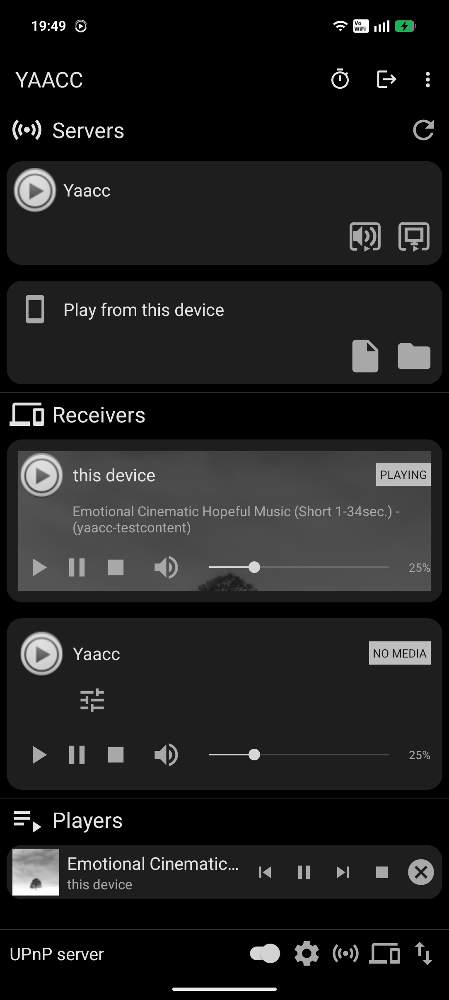
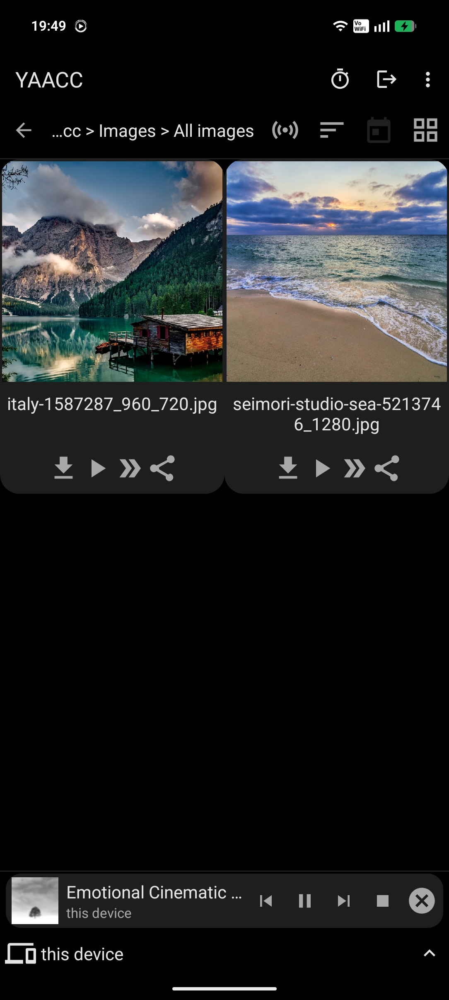
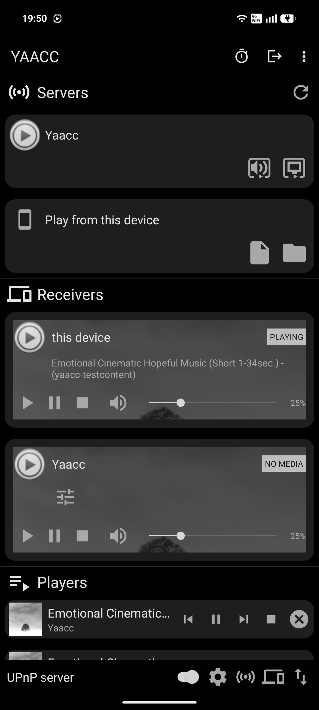
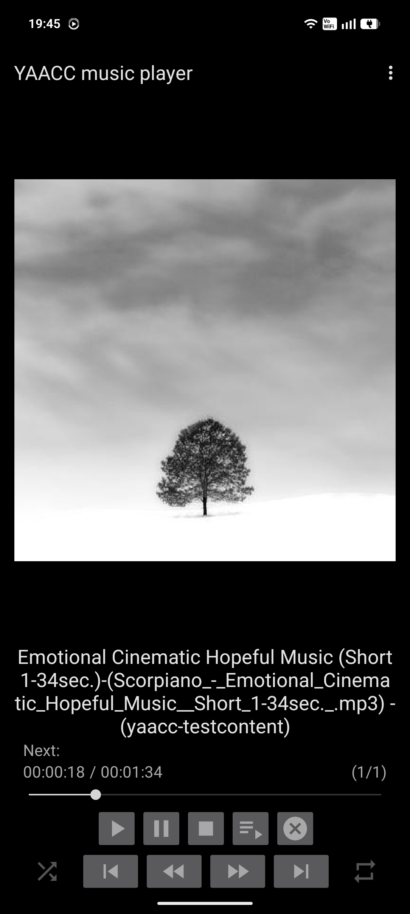
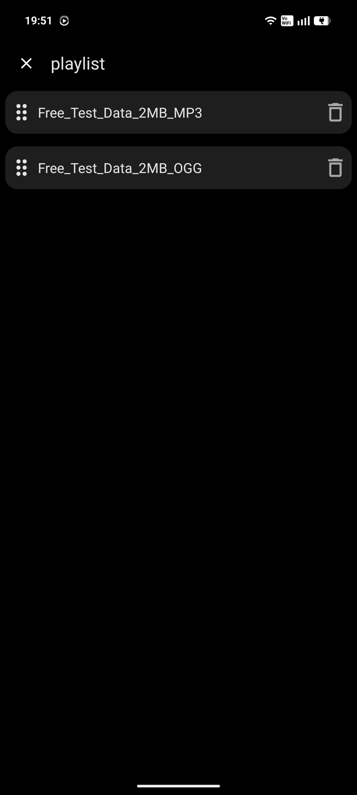
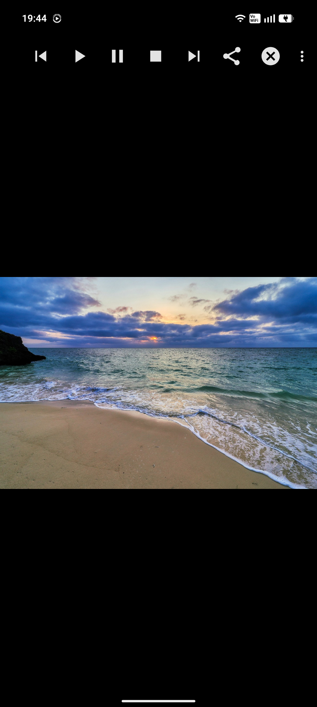

# YAACC - UPNP Client and Server

## About YAACC

YAACC (Yet Another Android Client Controller) is a hobby project I am working on in my free time. So
it's not perfect and I am only able to test the app with my own hardware setup.

Please, help improving YAACC by reporting problems or sending pull requests.

Have fun!

tobexyz

[](https://f-droid.org/packages/de.yaacc/)


)


  
  

## Description

The App allows you to play media from UPnP/DLNA devices in your network on your android device or
any capable UPnP device in your network. It is also possible to start an UPnP server on your device
in order to play media from your device on any UPnP renderer in your network.

## Features

* UPnP/DLNA Server - share files of your device in the network
* Images and videos are offered in galleries by directory, and as one list of all
* UPnP/DLNA Client - receive media from other devices on your device
* UPnP/DLNA Controller - control media renderer in the network
* Live streaming - stream system audio and screen to network devices (Android 10+)
* SAF support - browse and share files from external storage, USB drives, SD cards
* Lock screen controls - hardware volume buttons and media controls
* Receiver controls - play/pause/stop directly from the receiver tab (classic) or the receivers list and sheet (new layout) with status display
* Single-screen layout (Settings > Appearance > Layout): servers, receivers and the running players on one page; a fresh install starts in the single screen, an updated installation keeps the classic tabs
* Sort browsed folders by name or date added, with server-side sorting when supported
* Control multiple media renderer
* OpenHome: play on OpenHome devices (the device keeps and shows its playlist, which you can edit), and let OpenHome control points play on the app
* Yamaha MusicCast devices: link them into a group, group volume, now playing and controls of their own sources, presets, device settings, a power button on the card (see the documentation)
* Snapcast multi-room servers: every group is a receiver with group volume and mute, per-client volume, latency and name, the stream of the group and linking or unlinking clients; play music from the phone to a group, let the YAACC renderer play into a group, and use the phone as a Snapcast client (PCM and FLAC) (see [Snapcast](#snapcast))
* FCast receivers: found by mDNS or added by address, device name, connection link or by opening the QR code of a receiver with the camera app; play music, video and pictures to them with play, pause, seek, volume (mute and speed while a player plays) and your queue (see [FCast](#fcast))
* Allow download files to the device
* Share a link or one audio, video or image file from another app and play it on the receivers you pick
* Share an item you browse with other apps, as a file or as a link
* Pick files or a folder of your device and play them on the receivers you pick, each file is offered on the network only while it plays
* Use your device as an proxy if your media renderer can't process https media URLs
* Battery optimized with smart WiFi lock and foreground service management

## Configuration

Please take a look in the settings of the app. A lot of configuration can be done there.

The media server is stopped by default and has to be activated in the settings.
For this go to settings and tick some checkboxes under "Local server configuration" depending
on your configuration needs. You can start the server by activating the corresponding setting
or by activating the switch at the bottom of the server tab

## Snapcast

YAACC can control an existing [Snapcast](https://github.com/snapcast/snapcast) multi-room server (snapserver) and play music from the phone to one of its groups. This is controlled in *Settings* > *Snapcast*:

* **Control.** Add a server by address (or let YAACC find servers that announce themselves with mDNS; that search is on by default, sends mDNS queries on the network (also on the first screen of a fresh install) and is not authenticated, so clear it in networks you do not trust). Each Snapcast group then appears among the receivers: group volume and mute, volume, latency and name of each client, the stream of the group, and linking or unlinking clients of the group (offline clients can be removed from the server). A group belongs to one server; YAACC never becomes a snapserver and cannot move clients between servers.
* **Play to a group (on by default; an installation that stored "off" keeps it off).** YAACC asks the server to add a TCP stream at runtime (`Stream.AddStream`) and sends the audio of what it plays (raw PCM, 48 kHz, 16 bit, stereo) into it; one receiver is one Snapcast group. Music only. The clients play about one second behind the display (the buffer of the server), so pause, stop and seek are heard that late. The server must allow adding a TCP stream source at run time; there is no fallback for one that refuses.
* **The YAACC renderer into a group.** *Settings* > *UPnP server* > *Output*: with *Snapcast group* (and a server and group chosen there) the media renderer, the one other apps and UPnP/OpenHome controllers play to, only feeds that group; the phone stays silent and is not made a Snapcast client or a member of the group (which clients are members is your choice in the link sheet). The volume and mute that a controller sets and reads are the group's. A refused play (no group, server not in the list or not answering, group gone, video or images, unknown content type) says so on the phone and the controller sees *STOPPED*. The audio goes unencrypted to the server, like the option above, and anything on the network that can reach the renderer can change the volume of the whole group. Default is *This device*, which changes nothing.
* **The phone as a Snapcast client (off by default).** *Settings* > *Snapcast* > *Snapcast client* adds a switch to the first page (and a card in the receiver list) that makes the phone play as a client of a server, in sync with the other clients of its group. It plays **PCM and FLAC** only (Opus and Vorbis are a possible future enhancement, such a stream is refused with a message). It connects to the stream port 1704. **How well the sync holds depends on the phone and on the Wi-Fi:** the output latency the phone reports, Wi-Fi power saving and Doze (from Android 14 no Wi-Fi lock works with the screen off), the output's buffer and a Bluetooth route (a latency field helps) all matter, and no measurement against other clients over a long time exists. Audio focus (a call), the pause when headphones are pulled and a ramp of the gain are not built. The phone gives every server the same generated client id, and the name of the phone and of your YAACC server with the app version; the switch is remembered and restored when the app starts (also after a reboot with *autostart server on boot* checked). See the [documentation](https://tobexyz.github.io/yaacc-code/#this-phone-as-a-snapcast-client).
* **Requirements.** A snapserver you can reach: its control port (TCP 1705 by default), for playing the ports 4953 to 4962 that the stream is opened on, and for the phone's own client the stream port 1704 (open them in the server's firewall; see the troubleshooting below). A server with authorization (a login) switched on is not supported. Tested with the Docker rig below, which builds one development commit of Snapcast (November 2026, version number 0.35.0; the 0.35.0 release itself was not tried), and by the author on his devices with a snapserver; other servers, devices and networks have not been tested.
* **Troubleshooting: "Could not connect to the stream of the Snapcast server".** The server accepted the stream, but nothing accepted the TCP connection on the stream's port. The usual cause is a firewall on the server (ufw, firewalld, a Docker publish limited to 127.0.0.1): the TCP ports 1704 (stream), 1705 (control) and 4953-4962 (YAACC's feed streams) must be reachable from the phone. With ufw: `sudo ufw allow 1704/tcp`, `sudo ufw allow 1705/tcp`, `sudo ufw allow 4953:4962/tcp`. The debug log line `connect failed: <exception class> (port <n>)` names the failure and the port.
* **Security.** The connections YAACC uses (the raw TCP control port, the stream ports of the feed and the stream port of the phone's own client) are neither encrypted nor authenticated: the audio goes unencrypted to whoever answers at the address of the server you chose (and the audio the phone's client plays comes unencrypted from it), any device that can reach the YAACC renderer can change the volume and mute of the group while its output is a Snapcast group, and the name of your stream carries the name of the phone ("network name for local server") plus a random identifier, and the Snapcast client gives every server (also a public address) the same generated client id, and the name of the phone and of your YAACC server with the app version (a public address gets the generic *YAACC* and the app version). The search for servers is on by default: it sends mDNS queries on the network and contacts every server that announces itself. Discovered servers can be spoofed by any host on the network, and the stream port accepts audio from any host that can reach it. Use it only inside a network you trust, and do not type in a public address. YAACC stores no credentials. Details and the other limits are in the [documentation](https://tobexyz.github.io/yaacc-code/#snapcast).
* **Test rig.** `tools/snapcast-rig/` has a Docker setup with one snapserver and two snapclients for development and testing (loopback ports only, no sound output): `cd tools/snapcast-rig && docker compose up --build`, see its [README](tools/snapcast-rig/README.md). It builds the upstream Snapcast sources at a fixed commit; no Snapcast code is part of YAACC.

Snapcast is free software under the GNU General Public License version 3 or, at your option, any later version. Snapcast is the name of an open source project of its authors; YAACC is not affiliated with, authorized or endorsed by the Snapcast project or its authors. The name is used as plain text only; YAACC does not show the Snapcast logo.

## FCast

[FCast](https://fcast.org) is an open casting protocol with receivers for Android TV, phones and computers. YAACC is an FCast **sender**: it finds receivers, sends them the address of an item (music, video or picture from a UPnP server, your own files or a shared link) and controls the playback. It is never an FCast receiver. This is controlled in *Settings* > *FCast*:

* **Finding receivers.** *Find FCast receivers* (on by default) searches the local network by mDNS (`_fcast._tcp`) while a page with the receiver list or the list of FCast receivers is open. It sends mDNS queries on the network and lists every device that announces itself; announcements are not authenticated, so anyone on the network can announce a receiver. Nothing is played to a receiver before you choose it. Each receiver is a card in the receiver list.
* **Adding receivers.** *Settings* > *FCast* > *FCast receivers* adds a receiver by an **address** (`host` or `host:port`, the port is 46899 by default), by the **name of the device** (a receiver that was found, a name the system can look up, or a search of four seconds), or by a pasted **connection link** (`fcast://r/...`, the text of the QR code that the receivers show). You can also read the QR code with the **camera app** of your phone and open the link with YAACC: a dialog shows the name and the addresses, and nothing is stored before you tap *Add*. YAACC needs no camera permission for that. If a link lists several addresses, those of the network the phone uses are tried first, the others only if none of them answers. Only addresses of the local network are accepted from a link or a name. IPv6 link-local addresses (`fe80::`) are not accepted, use the IPv4 address.
* **Playing.** Music, video and pictures from any source of YAACC. YAACC sends one item at a time and keeps the queue itself (next, previous, repeat, shuffle, the list); the next item starts when the receiver reports the end of the current one, a picture stays as long as *picture stay duration* says. There can be a short gap between two items. A card has play, pause, stop, the volume, and a gear that opens the settings sheet of the receiver. The volume of a receiver is not changed when an item starts.
* **The settings sheet.** What the protocol can control and show: the device (name, address, how it was found, the receiver app, the protocol version in use), the volume, mute and speed (these two while a player plays to the receiver), stop, a connection check and *Reconnect*, a short trace of what the sheet saw (with *Copy trace*), and *Remove* for a receiver you added by hand. The FCast protocol cannot read or change the receiver's own settings; those stay on the receiver. An idle card has no connection: YAACC connects when you use the receiver and closes the connection a little after.
* **Requirements.** A receiver that speaks FCast protocol version 3 (the desktop receiver and the Android receiver do) that your phone can reach: mDNS multicast (UDP 5353) must pass between the phone and the receiver (some Wi-Fi networks isolate devices or block multicast; then add the receiver by address) and the receiver's TCP port 46899 must be open in its firewall, for example `sudo ufw allow 46899/tcp`. The receiver fetches the item itself, so it must also be able to reach your UPnP server or the phone.
* **Limits.** Protocol version 3 only. Version 4 (encrypted, with audio tracks and subtitles) is not supported yet. No playlist is sent to the receiver, no tracks or subtitles, no grouping and no screen mirroring. The protocol has no mute: YAACC sets the volume to 0 and restores it. Receivers differ in how they report the end of an item; YAACC uses the end event, a paused state at the end and, as a safety net, two seconds of silence near the end. What a receiver does with a displayed picture is not known for all receivers. Tested by the author with FCast receivers on his own devices and in automated tests and a test receiver; other receivers, devices and networks have not been tested.
* **Security.** FCast version 3 is neither encrypted nor authenticated: the commands and the **full address of every item**, with any user name or token it carries, go in plain text to the receiver you chose, and anyone on the network who can reach a receiver can control it. Use it only inside a network you trust, and do not type in a public address. YAACC stores no credentials, opens no listening port for FCast and sends no cookies or headers.
* **Test receiver.** `tools/fcast-rig/` has a small receiver for development and testing (it announces itself, logs what it is sent and answers like a receiver, no media player): see its [README](tools/fcast-rig/README.md). It contains no FCast code.

This application is an independent community implementation of the FCast protocol. It is not affiliated with FUTO. FCast is a registered trademark of FUTO.

## A word about the cling library

YAACC is based on the work of [Cling](https://github.com/4thline/cling). This great UPnP library
made YAACC possible, and all honor belongs to its authors. Thank you for your work!

Cling itself is no longer maintained; the fork [jUPnP](https://github.com/jupnp/jupnp) continues
that work. YAACC still uses its own copy of the parts of Cling it needs, which is included in this
repository.

## Build dependencies

Android SDK (set ANDROID_HOME or create a local.properties file to point to it)

## Build from source

Build the project by running following command in the project root:

```./gradlew build```

After the build has finished the debug apk is located in
```./yaacc/build/outputs/apk/debug/yaacc-debug.apk```

## Documentation

<https://tobexyz.github.io/yaacc-code>

## Trademarks

Android and Android TV are trademarks of Google LLC. UPnP and DLNA are trademarks or certification marks of their respective owners; YAACC is not UPnP or DLNA certified. Yamaha and MusicCast are trademarks or registered trademarks of Yamaha Corporation. Snapcast is the name of an open source project of its authors. Home Assistant, VLC, Kodi, BubbleUPnP, Windows and the other product and company names mentioned in this documentation are trademarks or registered trademarks of their respective owners and are used only to identify compatible products. YAACC is an independent project and is not affiliated with, authorized or endorsed by any of them.
