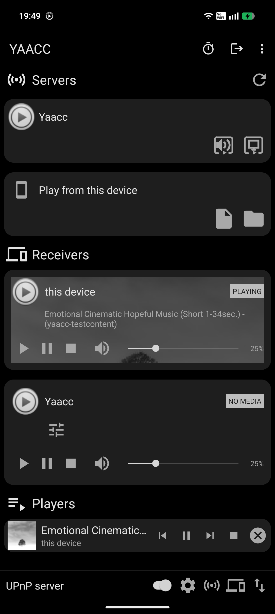
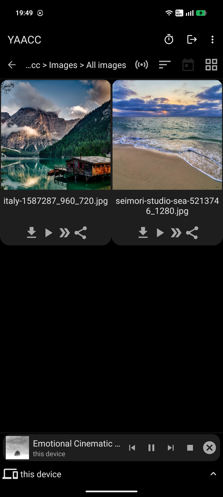
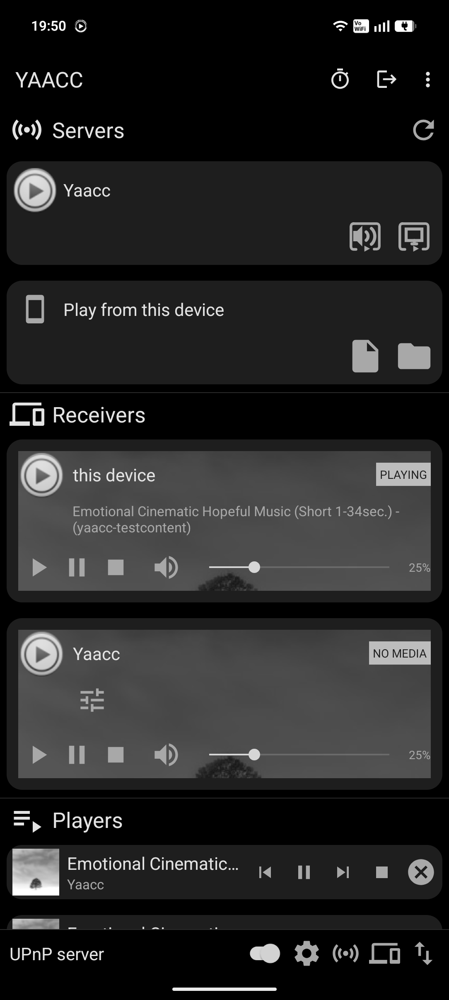
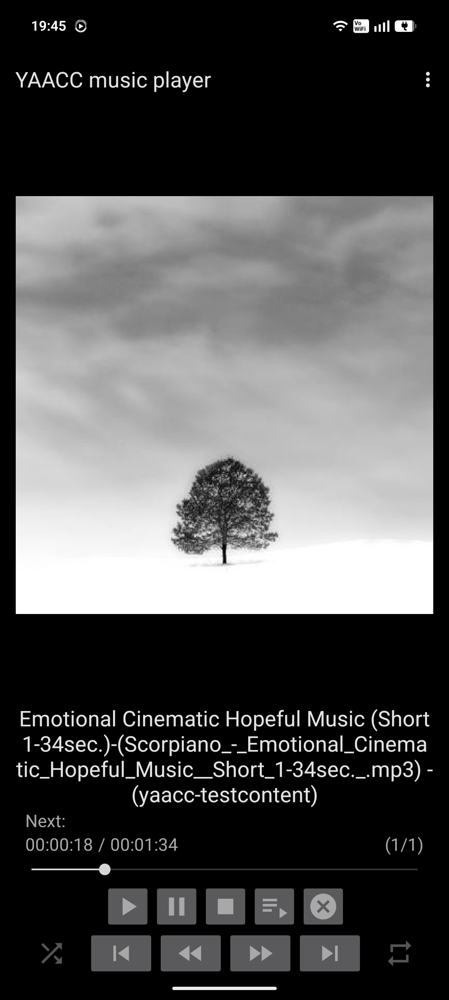
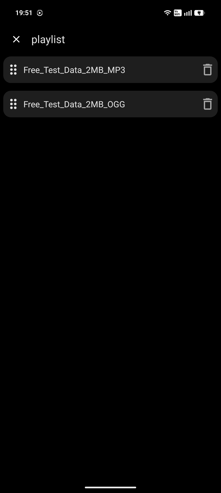
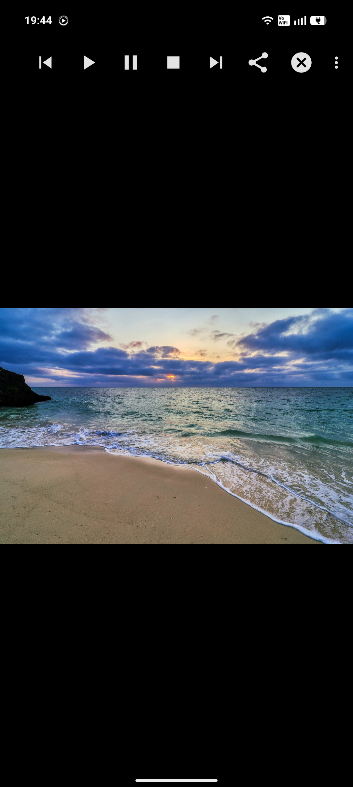

# YAACC - UPNP Client and Server

## About YAACC

YAACC (Yet Another Android Client Controller) is a hobby project I am working on in my free time. So
it's not perfect and I am only able to test the app with my own hardware setup.

Please, help improving YAACC by reporting problems or sending pull requests.

Have fun!

tobexyz

[](https://f-droid.org/packages/de.yaacc/)


)


  
  

## Description

The App allows you to play media from UPnP/DLNA devices in your network on your android device or
any capable UPnP device in your network. It is also possible to start an UPnP server on your device
in order to play media from your device on any UPnP renderer in your network.

## Features

* UPnP/DLNA Server - share files of your device in the network
* Images and videos are offered in galleries by directory, and as one list of all
* UPnP/DLNA Client - receive media from other devices on your device
* UPnP/DLNA Controller - control media renderer in the network
* Live streaming - stream system audio and screen to network devices (Android 10+)
* SAF support - browse and share files from external storage, USB drives, SD cards
* Lock screen controls - hardware volume buttons and media controls
* Receiver controls - play/pause/stop directly from the receiver tab (classic) or the receivers list and sheet (new layout) with status display
* Single-screen layout (Settings > Appearance > Layout): servers, receivers and the running players on one page; a fresh install starts in the single screen, an updated installation keeps the classic tabs
* Sort browsed folders by name or date added, with server-side sorting when supported
* Control multiple media renderer
* OpenHome: play on OpenHome devices (the device keeps and shows its playlist, which you can edit), and let OpenHome control points play on the app
* Yamaha MusicCast devices: link them into a group, group volume, now playing and controls of their own sources, presets, device settings (see the documentation)
* Snapcast multi-room servers: every group is a receiver with group volume and mute, per-client volume, latency and name, the stream of the group and adding or removing clients; experimental: play music from the phone to a group (see [Snapcast](#snapcast))
* Allow download files to the device
* Share a link or one audio, video or image file from another app and play it on the receivers you pick
* Share an item you browse with other apps, as a file or as a link
* Pick files or a folder of your device and play them on the receivers you pick, each file is offered on the network only while it plays
* Use your device as an proxy if your media renderer can't process https media URLs
* Battery optimized with smart WiFi lock and foreground service management

## Configuration

Please take a look in the settings of the app. A lot of configuration can be done there.

The media server is stopped by default and has to be activated in the settings.
For this go to settings and tick some checkboxes under "Local server configuration" depending
on your configuration needs. You can start the server by activating the corresponding setting
or by activating the switch at the bottom of the server tab

## Snapcast

YAACC can control an existing [Snapcast](https://github.com/snapcast/snapcast) multi-room server (snapserver) and, as an experimental option, play music from the phone to one of its groups. This is controlled in *Settings* > *Snapcast (experimental)*:

* **Control.** (New: checked against the test rig and in automated tests, not yet on a phone.) Add a server by address (or let YAACC find servers that announce themselves with mDNS; that search is on by default, sends mDNS queries on the Wi-Fi and is not authenticated, so clear it in networks you do not trust). Each Snapcast group then appears among the receivers: group volume and mute, volume, latency and name of each client, the stream of the group, and adding or removing clients of the group. A group belongs to one server; YAACC never becomes a snapserver and cannot move clients between servers.
* **Play to a group (experimental, off by default, not tested on a device with real speakers yet).** YAACC asks the server to add a TCP stream at runtime (`Stream.AddStream`) and sends the audio of what it plays (raw PCM, 48 kHz, 16 bit, stereo) into it; one receiver is one Snapcast group. Music only. The clients play about one second behind the display (the buffer of the server), so pause, stop and seek are heard that late.
* **Requirements.** A snapserver you can reach: its control port (1705 by default) and, for playing, the ports 4953 to 4962 that the stream is opened on. Tested only in the Docker rig below, which builds one development commit of Snapcast (November 2026, version number 0.35.0; the 0.35.0 release itself was not tried); a server with authorization (a login) switched on is not supported.
* **Security.** The connections YAACC uses (the raw TCP control and stream ports of a snapserver) are neither encrypted nor authenticated: the audio goes unencrypted to whoever answers at the address of the server you chose, and the name of your stream carries the name of the phone ("network name for local server") plus a random identifier. Discovered servers can be spoofed by any host on the network, and the stream port accepts audio from any host that can reach it. Use it only inside a network you trust, and do not type in a public address. YAACC stores no credentials. Details and the other limits are in the [documentation](https://tobexyz.github.io/yaacc-code/#snapcast).
* **Test rig.** `tools/snapcast-rig/` has a Docker setup with one snapserver and two snapclients for development and testing (loopback ports only, no sound output): `cd tools/snapcast-rig && docker compose up --build`, see its [README](tools/snapcast-rig/README.md). It builds the upstream Snapcast sources at a fixed commit; no Snapcast code is part of YAACC.

Snapcast is free software under the GNU General Public License version 3 or, at your option, any later version. Snapcast is the name of an open source project of its authors; YAACC is not affiliated with, authorized or endorsed by the Snapcast project or its authors.

## A word about the cling library

YAACC is based on the work of [Cling](https://github.com/4thline/cling). This great UPnP library
made YAACC possible, and all honor belongs to its authors. Thank you for your work!

Cling itself is no longer maintained; the fork [jUPnP](https://github.com/jupnp/jupnp) continues
that work. YAACC still uses its own copy of the parts of Cling it needs, which is included in this
repository.

## Build dependencies

Android SDK (set ANDROID_HOME or create a local.properties file to point to it)

## Build from source

Build the project by running following command in the project root:

```./gradlew build```

After the build has finished the debug apk is located in
```./yaacc/build/outputs/apk/debug/yaacc-debug.apk```

## Documentation

<https://tobexyz.github.io/yaacc-code>

## Trademarks

Android and Android TV are trademarks of Google LLC. UPnP and DLNA are trademarks or certification marks of their respective owners; YAACC is not UPnP or DLNA certified. Yamaha and MusicCast are trademarks or registered trademarks of Yamaha Corporation. Snapcast is the name of an open source project of its authors. Home Assistant, VLC, Kodi, BubbleUPnP, Windows and the other product and company names mentioned in this documentation are trademarks or registered trademarks of their respective owners and are used only to identify compatible products. YAACC is an independent project and is not affiliated with, authorized or endorsed by any of them.
