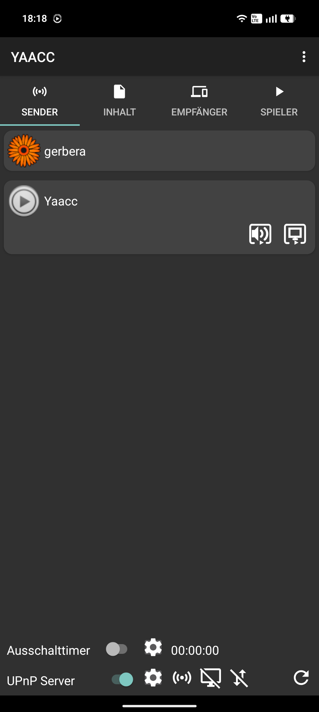
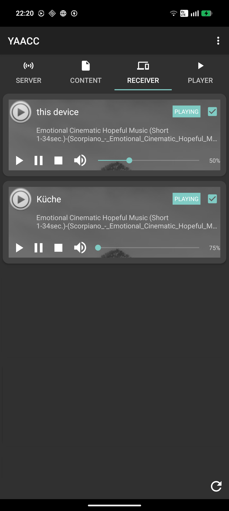
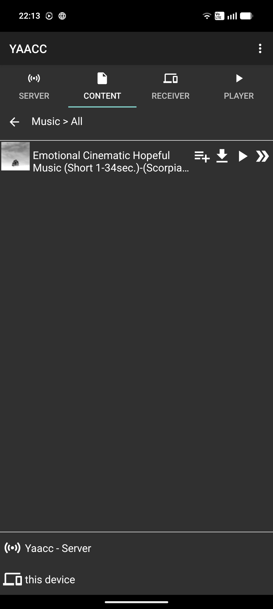
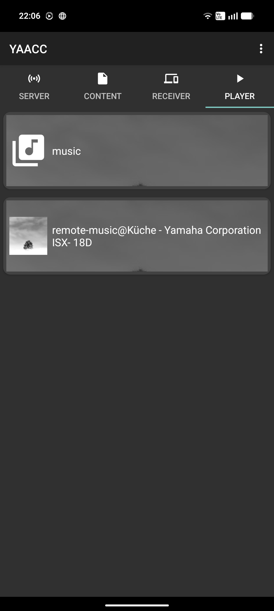
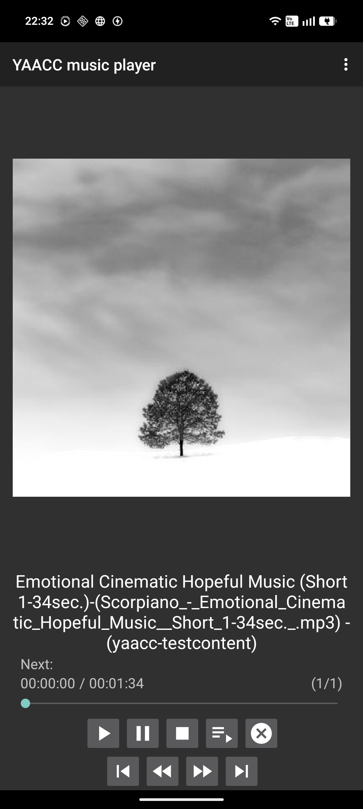
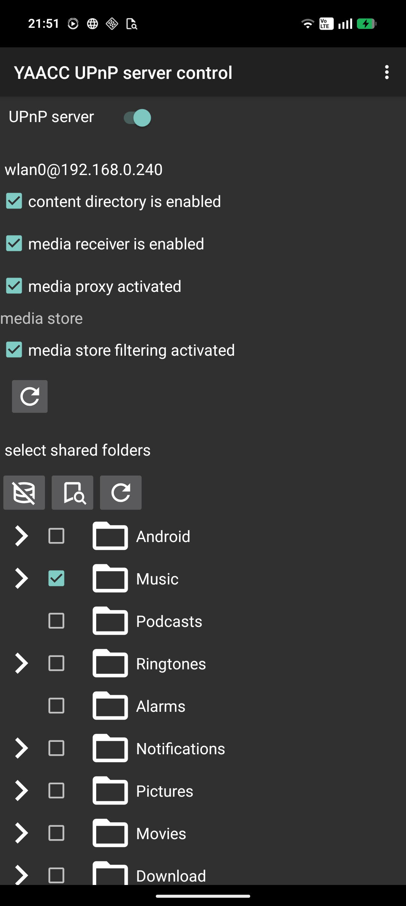
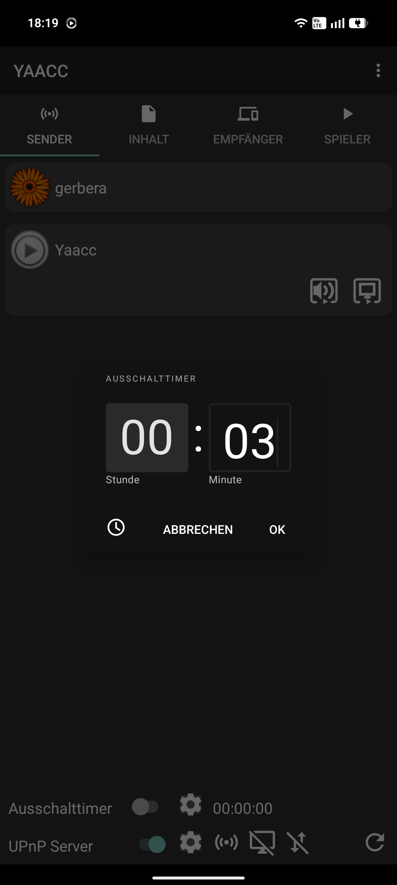

<!-- markdownlint-configure-file {
    "first-line-h1": false
} -->

* TOC
{:toc}

# Features

* UPnP/DLNA Server - share files of your device in the network
* UPnP/DLNA Client - receive media from other devices on your device
* UPnP/DLNA Controller - control media renderer in the network
* Control multiple media renderer
* Link Yamaha MusicCast devices into a group, set the group volume, control their own sources (now playing, tuner, presets) and change device settings, see [MusicCast devices](#musiccast-devices)
* Play music on OpenHome devices, which keep the playlist themselves, and let OpenHome control points play on YAACC, see [OpenHome](#openhome)
* Allow download files to the device
* Share a link (http or https) or one audio, video or image file from another app to YAACC and play it on the receivers you pick, see [Sharing to YAACC](#sharing-to-yaacc)
* Pick files or a folder of your device and play them on the receivers you pick without serving them constantly, see [Playing files from this device](#playing-files-from-this-device)
* Use your device as an proxy if your media renderer can't process https media URLs
* Download files to the device for offline access
* A Shutdown timer stops the running players and the app after a given time
* Sort browsed content by name or date, ascending or descending
* Android TV support (leanback launcher)
* Two layouts: the classic tabs or a single screen (the default of a fresh install) with a mini-player, chosen in the settings

# Usage

YAACC has two layouts. A fresh install and an installation updated from a version without this setting start in the new layout; a layout you chose before stays. You switch
in the settings under *Appearance* >
*Layout*: choose "Classic (tabs)" or "New (single screen)". The change takes
effect when you return from the settings to the app screen; running players keep
playing. This page describes the classic layout first, see
[New layout](#new-layout-single-screen) for the single screen.

In the classic layout all UPnP/DLNA servers in your network are listed on the
first screen. Select one and the app will automatically switch to the content tab.
It allows to browse the content provided by the selected server.

{:height="30%" width="30%"}

Before playing content make sure you have chosen a receiver. In the classic
layout you tick receivers on the receiver tab. In the new layout there is no
persistent selection: every time you play, the "Play on…" list asks for the
receivers, see [Choosing receivers](#choosing-receivers-new-layout) and
[Receiver controls](#receiver-controls).
Receivers are either UPnP/DLNA media renderers in your network or the
android device itself.

{:height="30%" width="30%"}

Normally senders and receivers will appear automatically.
If not you can use the refresh button at the bottom of
the sender and receiver tab to trigger a new search for devices
(in the new layout: the refresh button in the "Servers" header).

## New layout (single screen)

Switch to it with *Settings* > *Appearance* > *Layout* > "New (single screen)".
Switching back to "Classic (tabs)" works the same way. A fresh install starts in
the new layout (also on Android TV, where it has not been checked with a TV
remote yet); an updated installation without a stored layout starts in the new layout.
There are no tabs. The screen shows one level at a time:

* **Servers** is the top level. The "Servers" header has the refresh button to
  search for devices again. Below it all UPnP/DLNA servers in your network are
  listed; the YAACC entry has the live streaming buttons (see
  [Live streaming](#live-streaming-android-10)). At the bottom are the YAACC
  server switch with the button for the server settings, and the icons showing
  whether the device acts as media provider, media renderer or proxy
  (see [Media server](#media-server)). These bottom controls exist only on
  this level.
* **Content**: tap a server to browse it, see [Content browsing](#content-browsing).
  The arrow in front of the path and the system back button go back one step at a
  time: from a folder to the parent folder, from the root of a server to the
  server list, and from the server list the app exits. The server button in the
  header of the content (next to the sort and the view buttons) shows the server
  list at once from any folder depth, so you can change the server without going
  back folder by folder.
* **Toolbar**: the timer symbol is the [shutdown timer](#shutdown-timer) and its
  only entry. While a timer runs, a tap stops it and the remaining time is shown
  under the title of the toolbar. Otherwise a tap opens the duration picker; confirming a
  duration above 0 starts the timer. The overflow menu has the settings, the log
  and the about page, and the exit button quits the app.
* **Receiver bar**: at the bottom of every level. It shows the names of the
  receivers that are playing something right now (a paused player counts), or
  "No receiver playing". It does not show a selection. Tap it to open the device
  sheet, see [Receiver controls](#receiver-controls).
* **Mini-player**: directly above the receiver bar. It shows every running player
  as one compact row: the album art when available, the title, the name of the
  receiver it plays on, and the buttons previous, play/pause, next, stop and exit (stop only stops the
  playback, exit removes the player). Tap a row itself to open that player's screen. The rows are in the same order as the
  players in the device sheet (the one started first is on top). Up to about three
  rows are visible; with more players the list scrolls inside the mini-player. The
  mini-player is hidden when no player is running.

## Content browsing

The content browsing has a bread crumb on the top.
Behind each content entry different symbols are showing the possible actions:

* add an item to the playlist
* download the item
* play the item
* play all items on the same directory level

The bread crumb starts with the name of the selected server. The arrow in front
of it goes up one folder (in the new layout it also leaves the server at its
root folder).

In the classic layout the bottom of the screen shows two lines: the name of the
selected server and the names of the selected receivers (separated by "; "),
each with its icon. They only display the current selection; choose the
receivers on the receiver tab. Playing while no receiver is selected shows a
message asking you to select one there.

In the new layout the receiver bar at the bottom shows the receivers that are
playing; tap it to open the device sheet. Playing does not use a stored selection:
play, play all, tapping an item, and add to playlist first open the "Play on…"
list, see [Choosing receivers](#choosing-receivers-new-layout).

A button in the folder header switches between a list and a grid of cards (the
same entries and the same buttons); the cards are the default of a fresh install
and your choice is remembered. In landscape the cards are laid out in several
columns.

A toggle in the folder header lets you sort the current folder by name or date,
ascending or descending. yaacc uses the server's own sort support when browsing
a UPnP/DLNA server that offers it, falling back to sorting the results itself
otherwise. The chosen sort order is remembered across app restarts.

{:height="30%" width="30%"}

### Choosing receivers (new layout)

In the new layout the receiver is chosen for each action:

1. Tap play, play all, an item row, or add to playlist. A sheet titled "Play on…"
   opens with every receiver, including this device, and a checkbox per row.
   The receivers of your last confirmed choice are ticked, so the usual receiver
   is one tap away; on the very first use nothing is ticked.
2. Tick one or more receivers and tap "OK". With nothing ticked "OK" only shows
   "Choose at least one receiver." and the list stays open.
3. YAACC starts the playback on exactly those receivers. Afterwards nothing is
   selected again, so the next action asks again. The receiver bar shows the
   receivers that are playing.

"Cancel", the back button, a tap outside the list or dragging it down close it
and change nothing: nothing starts. While a previous action is still starting, a
short message says so and the list does not open.

"Add to playlist" adds the item to the playlists of the chosen receivers that
already have a player. Only if none of the chosen receivers has a player yet,
YAACC starts a new player on each chosen receiver. A chosen receiver without a
player is skipped while another chosen receiver already plays.

The classic layout keeps its way: tick receivers on the receiver tab, they stay
selected, and the bottom of the content tab shows two read-only lines (the
selected server and the selected receivers).

## Playing content

YAACC is able to control multiple players at the same time.
For example you are able to stream an image show with background music
on your device, starting a movie on a TV or play music on a
smart speaker at the same time.

Each player is displayed in the player tab (classic layout). The new layout has
no player tab: every running player has a row in the mini-player and is listed in
the device sheet under the receiver it plays on. Depending on the content type
and if the content is played by YAACC itself or a network device, the player ui differs.

{:height="30%" width="30%"}

YAACC includes a player for music and image shows.
Videos are played using a third parties app on the device.
The video app will start automatically, if video content is selected for playing

{:height="30%" width="30%"}

{:height="30%" width="30%"}

### Receiver controls

The receiver tab shows all available UPnP/DLNA renderers in your network, including your device.
Each renderer displays:

* Current playback status (PLAYING badge when active)
* Track title and album art (when available)
* Play/pause/stop controls
* Volume control
* Mute button

{:height="30%" width="30%"}

You can control playback directly from the receiver tab without opening the player view.
The controls work for both local playback and remote UPnP devices.

In the new layout there is no receiver tab: tap the receiver bar at the bottom of any
screen (or select it with the D-pad) to open the device sheet. The classic layout does not
have the sheet; use the receiver tab and the player tab there.
The sheet is titled "Receivers". It lists every receiver with its status, play/pause/stop, volume and mute controls,
and under each receiver the YAACC players currently running on it, in the order they were started.
It has no selection checkboxes: receivers are chosen when you start something,
see [Choosing receivers](#choosing-receivers-new-layout).
Players on a device that is no longer in the receiver list are shown at the end.
Tap a player to open its player view.

* On phones and tablets the sheet opens at half height. Drag it up for full height;
  drag it down or press Back to close it.
* On Android TV, or when using a D-pad, it opens at full height with the first receiver focused.
* While the sheet is open, receiver status and the list of running players update live.
  Status polling stops when the sheet is closed or the app goes to the background.

### Repeat and shuffle

Every player has its own repeat and shuffle buttons: the music player, the player of a
receiver (AVTransport) and the player for videos and mixed content have them next to the
previous/next buttons (the image viewer in its menu bar).

* **Repeat** cycles *off* (the playlist is played once, then the player stops), *all*
  (starts again with the first item after the last one) and *one* (the same item is
  played again and again; the next and previous buttons still skip to another item).
  The symbol shows a "1" for repeat one; a symbol drawn half transparent means off.
* **Shuffle** plays the items in a random order, every item once per round. Switching
  it on or off while playing keeps the current item; previous goes back through the
  order that was played.

The settings *Repeat for new players* and *Shuffle for new players* (see [Settings](settings.html); they
were called *replay playlist* and *shuffle music*) only give the mode a new player starts with. They are not a switch
for all players: every player, also one that Home Assistant controls, has its own mode. A change with the buttons belongs to that player
only: it is not written to the settings and ends with the player. The mode of the
player of YAACC's own media renderer can also be changed by a control point
(UPnP *SetPlayMode*, for example the repeat and shuffle services of Home Assistant), and a change
with the buttons is reported back to the control point.

### Lock screen controls

When playing media locally, YAACC provides lock screen controls:

* Play/pause/stop buttons
* Next/previous track
* Track metadata display
* Album art
* Hardware volume buttons control playback volume

## Live streaming (Android 10+)

YAACC can stream your device's screen and system audio to UPnP/DLNA renderers in your network.

### System audio streaming

Stream all audio playing on your device to network speakers or receivers:

* Captures system audio (music, podcasts, games, etc.)
* 44.1kHz stereo, high quality
* Works with most UPnP audio renderers
* Multiple simultaneous clients supported

**Note:** Some apps may block audio capture (DRM-protected content like Spotify, YouTube Premium).

### Screen casting

Stream your device's screen to TVs or displays:

* 720p video at 15fps
* MJPEG format for broad compatibility
* Works in web browsers and some UPnP video players
* Useful for presentations and screen sharing

### Enabling live streaming

1. Go to the Server tab (in the new layout: the Servers screen)
2. Find your local device in the list
3. Tap the audio or video button
4. Grant the microphone permission (needed to capture the device audio; the app records no microphone sound) and then the screen capture permission when prompted. If you deny either, the stream buttons stay off
5. The stream appears in the "Live Streams" folder

Access streams via UPnP or directly:
* Audio: `http://<device-ip>:49157/live/audio`
* Video: `http://<device-ip>:49157/live/video`

## Storage Access Framework (SAF)

YAACC supports browsing files from external storage, USB drives, and SD cards using Android's
Storage Access Framework. This allows sharing media from any storage location accessible on your device.

### Configuring SAF folders

In the server control view, you can add SAF folders to share:

1. Tap "Add SAF folder"
2. Select the folder using Android's file picker
3. Grant permission when prompted
4. The folder appears in the server content directory

{:height="30%" width="30%"}

### New files and folders

New files and folders inside an added SAF folder appear by themselves; you do not have to add the folder again. While the local server runs,
YAACC looks at the added folders (and at the folders your control points opened lately) every 30 seconds and tells the connected control points when something changed,
at most once every 15 seconds, so a download that is still running does not flood them. A new file or folder is therefore shown after about 30 to 45 seconds.
If a control point (media player, Home Assistant ...) still shows the old content after that, refresh the folder there or open it again; not every control point reacts to the message.
Changing which folders are ticked in the server settings is not announced; refresh the control point after that.

### Performance optimization

YAACC caches metadata (duration, MIME type, file size) for faster browsing:

* First browse: Extracts metadata from files
* Subsequent browses: Uses cached data
* Cache persists across app restarts
* Clear cache button available in server control view

The cache significantly improves browsing performance, especially for large media collections.

## Battery optimization

YAACC includes several battery-saving features:

### Smart WiFi lock management

The WiFi lock is only held when actually needed:

* Released when app is backgrounded (if server/renderer disabled)
* Released when no active streaming
* Automatically re-acquired when needed

### Smart foreground service

The player service intelligently manages foreground state:

* Foreground only when actively playing media
* Stops foreground when paused (notification hidden)
* Service stops completely when no players active

## Modern architecture

YAACC uses modern Android APIs for better performance and system integration:

* **Media3/ExoPlayer** - Modern media playback engine (replaces deprecated MediaPlayer)
* **MediaSession** - System-wide media controls and lock screen integration
* **Improved UPnP stack** - Enhanced reliability and network state handling
* **AudioPlaybackCapture** - System audio streaming (Android 10+)
* **MediaProjection** - Screen casting support

## MusicCast devices

YAACC recognizes receivers that are Yamaha MusicCast devices and offers a few extra controls on their rows (in the device sheet of the new layout and on the receiver tab of the classic layout). Other receivers are not changed in any way. A device counts as a MusicCast device when its UPnP description announces the address of the Yamaha Extended Control (YXC) interface; nothing is configured by hand. YAACC only works with devices that are already set up in your network (with the manufacturer's app); it does not add a device to the network or remove one.

### The row

Besides the usual status and controls, the row of a MusicCast device shows whether it is on, in standby or not reachable, its current input, and, while it is in a group, "Linked with <name>" (a group leader shows the names of its members). The row follows the device within a moment, also when you change something with another app or the remote control: the devices report changes by themselves, and YAACC reads them completely every 30 seconds in addition.

### The device's own sources

While a MusicCast device plays something of its own (net radio, a streaming service, a server on the network, the FM or DAB tuner) and YAACC plays nothing on it, the row shows a second line with what is playing (station, title, artist, or the frequency or service of the tuner) and adds controls for that source. Only what the device reports for the current source is shown:

* Play, pause and stop on the row work on the device's source. While YAACC plays or has paused something on the device, they stay with YAACC's own playback and the controls of the source are hidden.
* Previous, next, repeat and shuffle appear when the source supports them (net radio, for example, has only play and stop).
* Tuner: the two buttons step the FM frequency by one step; a long press scans to the next station (a tap stops the scan). A switch with both names, FM and DAB, changes the band; with DAB the two buttons select the previous or next service.
* The star button opens a sheet with the device's presets (the stored stations of the net source and of the tuner) and its recently played entries. Empty slots are not shown; a tap recalls the entry, which also switches the device to its input.

The controls act on the device only after YAACC has read its current state again, so a stale display does not send a wrong command.

### Linking devices

### Linking devices

The link button on the row opens a list of the other MusicCast devices in the same style as the receiver picker.

* Tick the devices that should play together with this one and confirm. This device becomes the group leader and the ticked devices follow it; they play in sync.
* On the row of a leader the button opens the list again with its members ticked: tick more devices to add them, untick some to remove them, untick all to end the group.
* The button is disabled on a device that is a member of someone else's group; change the group on the leader's row. Linking is also refused for devices that are already in another group (they are listed as "in another group") or that do not answer.
* A device that is removed from a group is put back on the input it used before it was linked, if YAACC has seen that input. If YAACC never saw an earlier input, the device stays on the link input (the row says "No group, still on the link input") and you choose its input in the device settings.
* Changing a group interrupts what is playing on the devices concerned.

### Playing on a group

When you play on a device that is a member of a group, YAACC sends the media to the leader of the group instead and tells you so ("Kitchen is linked with Living room. Playing on Living room."); the members play in sync with the leader. This also applies to files and folders picked with [Playing files from this device](#playing-files-from-this-device). In the receiver picker such a member is marked "plays via <leader>". If the leader of a group cannot be determined clearly, YAACC does not guess and asks you to play on the leader.

### Volume

The volume slider and the mute button of a MusicCast device use the device's own interface, because the generic UPnP volume control does not work for devices that are in a group. Every device keeps its own volume. The devices do not pass the volume of the leader on to the members by themselves. A leader therefore has an additional slider "Group volume": it shows the average of all members and moves every member by the same number of percentage points while you drag (each member stays within 0 to 100 %; dragging back restores every member's own level).

### Device settings

The settings button on the row opens a sheet with what the device reports as changeable: power, input, sound program, sleep timer, a three-band equalizer, the brightness of the display, the automatic standby and the link settings (audio delay, audio quality). Entries a device does not offer are not shown, and the sheet only offers the values the device reports. The sheet says so when the settings cannot be read or changed.

### Limits

* MusicCast devices only; no MusicCast account, streaming-service login, network or firmware setup, clock or alarm.
* Play, pause and stop on the row are those of the UPnP renderer while YAACC plays on the device; otherwise they control the device's own source. Searching and choosing content inside a streaming service or the net radio directory is not part of YAACC; use the presets or the manufacturer's app for that.
* Updates reach the app as UDP messages from the device to the phone. If the Wi-Fi isolates devices from each other, or the phone's Wi-Fi is in power save, they may not arrive; the row is then updated by the 30 second read.
* YAACC talks to a device only at the address it announced in your network, and shows everything a device sends as plain text.

Yamaha and MusicCast are trademarks or registered trademarks of Yamaha Corporation. OpenHome is the name of an open specification for networked music players and is used only to describe compatibility. YAACC is an independent project and is not affiliated with, authorized or endorsed by Yamaha.

## Media server

YAACC includes a media server service, which has to be enabled separately.
A switch for this is located at the bottom of the server list tab
(in the new layout: at the bottom of the Servers screen).

{:height="30%" width="30%"}

Depending on the configurations for the server in the settings,
the server service is used as media provider, media renderer or proxy.
The icons behind the server switch are showing which service is activated.

## Media provider

If the device is used as media provider, media files stored on the device
are accessible for other UPnP/DLNA devices in you network.

The shareable folders have to be configured using the server control view.
All included files and folders are accessible for other devices in your network.

The media of the phone are listed in the folders *Images*, *Videos* and *Music*. *Images* and *Videos* both
offer *All images* / *All videos* and *Galleries*: a gallery is one directory of the phone that holds images or videos
(for example *Camera*, *Download*, *Movies*), named like the directory. In the galleries of the *Videos*, two directories with
the same name are told apart by a number (*Camera (2)*), files directly in the root of a storage volume are listed in a
gallery named *(root folder)* (in the language of the app), and the media paths of the server settings apply to the list of
galleries and to the videos in a gallery.

{:height="30%" width="30%"}

The server control view is accessible through the settings button next to the server
switch at the bottom of the server list, or the YAACC server service notification.

## Media renderer

This service allows your device acting as an media renderer. Therefore the
device can be controlled by other UPnP/DLNA controllers in your network
and receive and play media from UPnP/DLNA servers.
Control points can set the play mode (*SetPlayMode*: `NORMAL`, `REPEAT_ONE`, `REPEAT_ALL`,
`SHUFFLE`, `RANDOM`; `DIRECT_1` and `INTRO` are accepted and played as normal) and read it
(*GetTransportSettings*, the `CurrentPlayMode` event). It is the repeat and shuffle mode of the
player the renderer plays on, see [Repeat and shuffle](#repeat-and-shuffle).

## Sharing to YAACC

Use the share menu of another app (gallery, files, browser, music player) and
choose YAACC to play something on the receivers in your network. Two kinds of
items are accepted:

* **A link.** The shared text is at most 2048 characters long and contains a link
  that starts with `http://` or `https://` and has a host. If an app shares a sentence
  with a link in it ("Look at this https://..."), the first link is used and the
  rest of the text is ignored. Text without such a link, other kinds of links and
  a shared `file:` link are not played; a short message says that YAACC only
  accepts audio, video and image files and web links. With the [media proxy](#media-proxy)
  switched on, links that point to this device itself (for example `localhost` or
  an address of this phone) or to a link-local address (`169.254.x.x`, `fe80::`)
  are not played; in the new layout the message "Could not play the shared link."
  appears.
* **One audio, video or image file.** Only a single file is accepted from the
  share menu, and the sending app must allow YAACC to read it. Several files,
  other file types and `file:` shares are ignored. To play several files or a
  folder, pick them in YAACC itself, see
  [Playing files from this device](#playing-files-from-this-device).

What happens next depends on the layout:

* **New layout.** The "Play on…" list opens (see
  [Choosing receivers](#choosing-receivers-new-layout)). Under the title it
  shows the name of the shared file, or "Link: <host>" for a link (the host of the
  link only, not the whole address, so you see which site is about to play). Nothing
  is opened, copied or played until you tick receivers and tap "OK". Cancel,
  back, a tap outside or waiting for two minutes discards the share. Only one
  share can wait at a time: a second one that arrives while the list is open or
  a share is waiting is ignored and a short message says so. If you rotate the
  device while the list is open, it closes and the share is discarded; share it
  again.
* **Classic layout.** A shared file opens the same "Play on…" list, with the
  receivers selected on the receiver tab already ticked. After "OK" the file plays
  on the ticked receivers and your previous selection is restored. A shared link
  plays on the selected receivers as before: YAACC waits a few seconds for
  receivers and, if none is found, plays it on this device. Normal browsing in
  the classic layout never shows this list.

A shared file is not copied when the sending app lets YAACC read it directly:
YAACC keeps it open and the built-in HTTP server hands it to the receivers, with
support for seeking. If the sending app provides the file only as a stream that
cannot seek, YAACC copies it into its private cache first (up to 512 MiB, and
only while enough free storage remains; the copy is deleted when the share ends
and leftovers are removed at the next start). Copying a big file can take a
while. If the file cannot be opened, the message "Could not play the shared
file." appears; "Another shared file is still being processed. Try again in a
moment." means the previous share has not finished.

A shared item (not files picked in YAACC, see below) is available to the receivers while a player is playing it and for
10 minutes after that player ended (renderers may still buffer or seek), but at
most 6 hours. Up to 8 shares can be active at once; if more are tried, "Too many
active shares. Try again in a moment." appears. Quitting YAACC ends all shares.
YAACC does not start or stop anything for a share and does not change your
settings: the built-in HTTP server runs whenever the app runs, whatever the
"local server state" setting says.

The address a receiver is given contains a random key. It is kept in memory only
and is never written to the settings. Who may use it is decided by the setting
[restrict the media proxy to the chosen receivers](settings/) (on by default).

## Playing files from this device

To play files or a folder of your phone on receivers without serving them
constantly, use the card "Play from this device" (with the phone icon) directly
below the servers in the server list. Tapping the card (or pressing the centre key of a D-pad on it) opens the file picker; the card also has two icon buttons:

* The **file** button opens the system file picker; pick one or
  more audio, video or image files.
* The **folder** button opens the system folder picker; the files
  directly inside the folder are used, sub folders are not. On Android 11 and
  later the system does not let you pick the root of the internal storage or the
  `Download` folder; pick a folder like `Music` or `Movies` instead.

Then the "Play on…" list opens (see [Choosing receivers](#choosing-receivers-new-layout);
in the classic layout the receivers selected on the receiver tab are ticked) and
"OK" starts the playback on exactly the ticked receivers. There is nothing to
browse: YAACC does not list the content of your phone, and the local server does
not have to run.

* Only audio, video and image files are played; other files are skipped. A
  folder is played in name order (numbers in numeric order: `track2` before
  `track10`), at most 500 files in all; a message says when files were skipped or
  could not be read.
* Audio, video and images go to their own players, which start together on each
  chosen receiver: a folder with songs, a video and photos starts the music
  player, the video player and the image show at the same time. A receiver that
  cannot play a kind fails for that player only.
* This phone plays audio and images straight from the files you picked. For any
  other receiver (and for video on this phone) a file is offered on the network
  only while it is the file being played: it gets its own random address when its
  turn comes and the address stops working as soon as the player moves on, stops
  or is closed. Only the receiver that plays it may fetch it. A queue needs one
  such address per player at a time (kinds times receivers), and the active ones
  are limited to 8 in all, see [Sharing to YAACC](#sharing-to-yaacc).
* If a file cannot be opened any more (moved, provider gone) it is skipped; after
  three in a row the player stops and says so.
* The access the system gives YAACC to the picked files lasts until the device
  restarts. You can edit the playlist (remove, move) while it plays.
* The length of a file is read when its turn comes, so receivers can show it and
  the next file starts after it. If it cannot be read (the provider is slow or
  the file has no length) the receiver decides when a file has ended.
* Videos on this phone open in the video app.

## Media proxy

The proxy service is used in the context of sharing URLs with YAACC and
playing the URL on a UPnP/DLNA device in your network. Normally the
URL will directly passed to the rendering device. Sometimes the rendering
device is not able to play https URLs. Therefore we need to get rid of the
encryption and provide the content with an unencrypted http URL.
For this the proxy service can be used. In that case the URL shared with
YAACC will not directly passed to the rendering device. YAACC generates a
new http based URL which points to YAACC and send the to the receiver.
When the content is played YAACC fetches the data from the origin through the
encrypted https connection an passed the content unencrypted through the http
connection to the rendering device. Because the content then travels unencrypted
to the rendering device, enable the proxy only on a network you trust.

The proxy address of a shared link is random, belongs to that one share, lives in
memory only and expires as described in [Sharing to YAACC](#sharing-to-yaacc).
Earlier versions stored the shared links in the settings; YAACC removes those
entries when it starts. Shared files always use this mechanism, whether or not
the "media proxy service" setting is on; the setting only decides whether a
shared link is proxied or handed to the receiver directly.

By default only the receivers you chose may fetch a shared item from the proxy
(setting "restrict the media proxy to the chosen receivers"). If a receiver is
refused, see [Settings](settings/) for when to switch this off.

For renderers with "enable server-side seeking for external URLs" switched on
(settings, per renderer), a shared link that is proxied also supports seeking
through the proxy, see [Settings](settings/).

## Appearance and log

*Settings* > *Appearance* > *Theme* offers "System" (follow the system setting), "Dark" and "Light"; a fresh install
starts with "Dark". The app is gray scale in Material 3 style: check boxes, switches, sliders and progress bars are gray in both
themes. The dark theme has a pure black page with slightly lighter bars, cards and sheets; the light theme has a light gray page and
a light title bar.

The log opens from the overflow menu ("log"). It shows the entries of the level chosen in the settings
(*Appearance* > *Log level*), refreshes every two seconds while it is open and scrolls down by itself only while you are
at the end. The clear button hides all entries from before the moment you pressed it.

## Shutdown timer

The shutdown timer stops all running players and the app after a certain time.
The timer is settable and can be enabled at the bottom of the server list tab and the remaining time
is displayed. In the new layout the timer is the symbol in the toolbar instead: tap it
while a timer runs to stop it (the remaining time is shown under the title of the toolbar); otherwise a tap opens the
duration picker, and confirming a duration above 0 starts the timer.

{:height="30%" width="30%"}

{:height="30%" width="30%"}

## OpenHome

OpenHome is an extension of UPnP for music players. Its devices keep the playlist themselves, so the playlist survives when the app is closed and other apps can control the same device. YAACC supports it in both directions. Nothing has to be switched on; the only choice you can make is described below.

**YAACC as the controller.** When a receiver offers the OpenHome Playlist and Product services, YAACC plays music on it with OpenHome: the playlist of the player screen is the playlist of the device (what you add is added to the device, what you delete is deleted on the device, what another app adds shows up here within a few seconds), and play, pause, next, previous, seek, volume, mute, repeat and shuffle go to the device. A device in standby is woken up, and its source is switched to the playlist. A playlist on an OpenHome device holds at most 1000 tracks; tracks beyond that are left out. Devices that speak OpenHome only (without AVTransport) are listed among the receivers too; their row has play, pause, stop, volume and mute (through the OpenHome volume service). Tracks of the playlist of a device can be dragged to another place (a device with OpenHome Playlist version 2 has an action for it; with version 1 the track is inserted again at the new place and the old entry is deleted, which gives it a new id), except the track that plays. A device that already plays, started by another app or before YAACC was reinstalled, is shown too: the row of an OpenHome-only device shows the state and the title of the track every ten seconds, and a tap on the row opens the player screen with the playlist and the current track of the device. Opening it only reads from the device (it is not woken up and its source is not changed); the first button you press does that. Videos and images, and devices without these services, are played with AVTransport as before. Repeat one does not exist in OpenHome and shows as repeat all. Tracks must have an http or https address. Audio files you pick on this phone are played on an OpenHome device too: the playlist of the player screen shows all of them, but, as for other receivers, a file is only shared with the device while it plays and while it is next, so the device gets the files two at a time (the current one and the next) and the app adds the following file when the device moves on. Picking a file in the playlist, or *previous*, shares the file again and starts it; files that are not on the device yet can be taken out of the list, the ones it has cannot. Video and images are not sent to a device that speaks OpenHome only (the app says so). The row of an OpenHome device has a settings icon, like a MusicCast device; it opens a sheet with *Power* (standby; the device is woken up when you play on it), *Source* (to switch the device to another of its sources, for example its radio or an input; YAACC only switches the source and does not control it, and playing from YAACC switches the device back to its playlist) and *Playback protocol* (to play on the device with AVTransport although it offers OpenHome; the choice is kept for that device).

**YAACC as the renderer.** The local renderer (*Settings* > local server > receiver) also offers the OpenHome services Product, Playlist, Info, Time and Volume next to AVTransport and RenderingControl. An OpenHome control point sees the app as a music player named like the app, with one source "Playlist", a queue of at most 1000 tracks and a standby state (a phone is not switched off: standby stops the playback and is reported to the control points, the queue stays, and playing or choosing a track wakes the app again); the tracks are played by the music player of the app. Control points that do not know OpenHome ignore the services and work as before. The services Product, Playlist, Info, Time and Volume are accompanied by a small Radio service: controllers that start a single stream with it (Home Assistant's "play media" does) replace the queue with that one track and play it; the app does not offer a radio source. The OpenHome services are always offered by the root device of the app (when the app serves files and plays, that is the media server device with the renderer embedded in it), because OpenHome controllers such as Home Assistant look there only. The queue and the playlist of the music player of the phone are one list: what an OpenHome control point adds, deletes or moves shows up in the playlist of the local music player, and what you delete, move or add there (tracks with an http or https address; other tracks are taken out again) is changed in the queue and shown to the control points within about a second. Like the AVTransport renderer, it can be used by every device in the network.

Not supported yet: playing radio, Songcast or other sources from YAACC (the source can be switched, see above).

## Trademarks

Android and Android TV are trademarks of Google LLC. UPnP and DLNA are trademarks or certification marks of their respective owners; YAACC is not UPnP or DLNA certified. Yamaha and MusicCast are trademarks or registered trademarks of Yamaha Corporation. Home Assistant, VLC, Kodi, BubbleUPnP, Windows and the other product and company names mentioned in this documentation are trademarks or registered trademarks of their respective owners and are used only to identify compatible products. YAACC is an independent project and is not affiliated with, authorized or endorsed by any of them.

| [Screenshots](screenshots/) | [Settings](settings/) |  [About](about/) | [Code](doxygen/html/inherits.html) | [Legal Notice (Impressum)](https://schoenesnetz.de/pages/disclamer_license/about.en.html) | [Privacy Policy](privacy.html)

