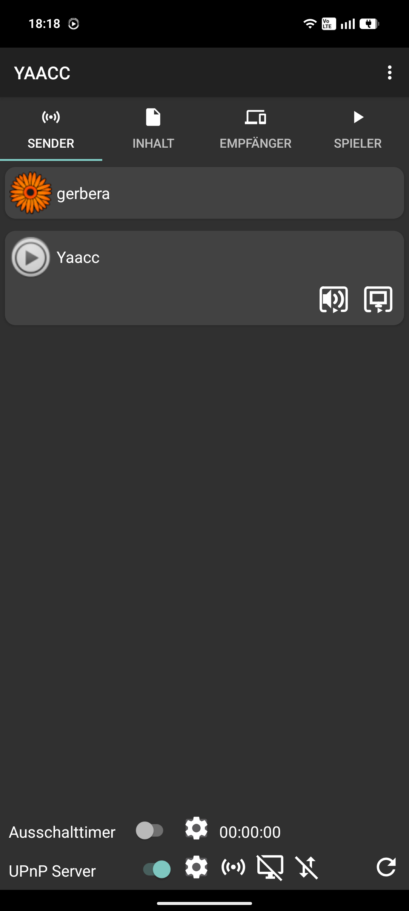
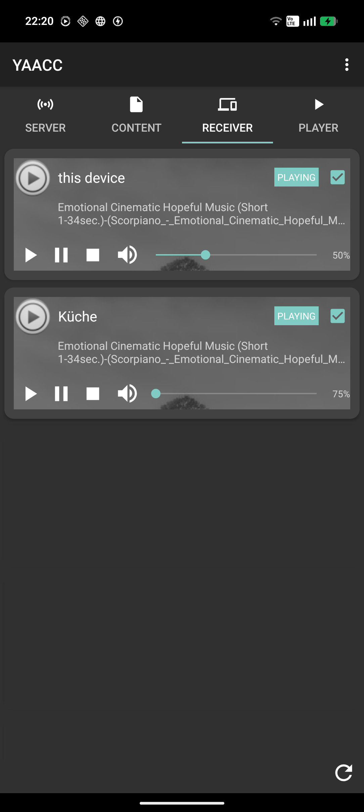
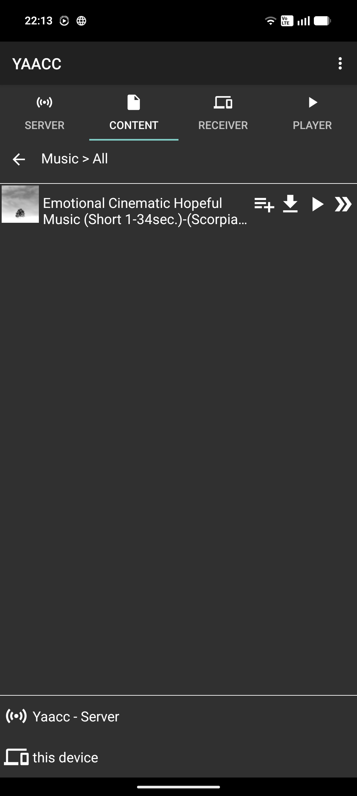
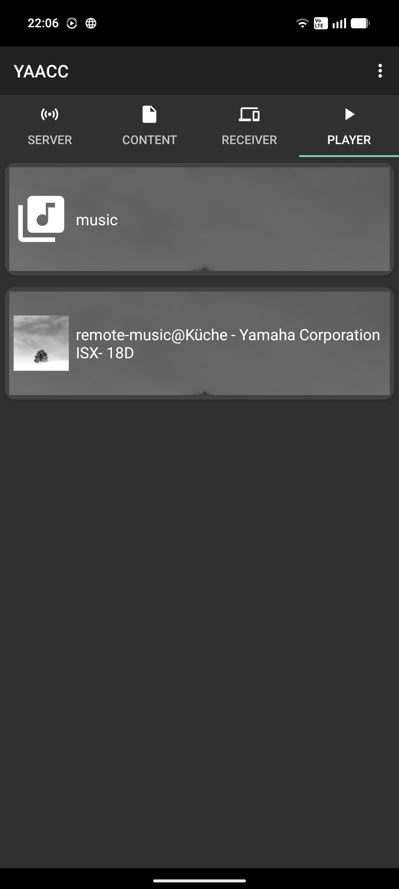
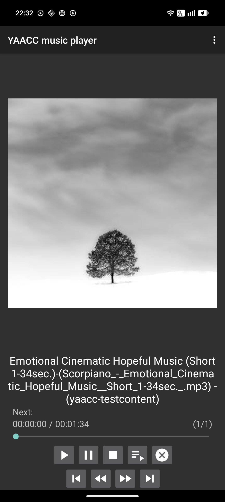
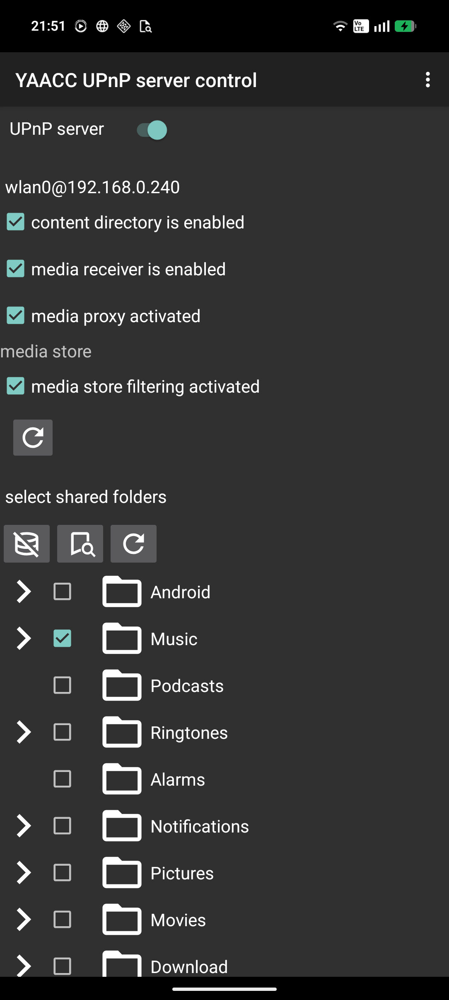
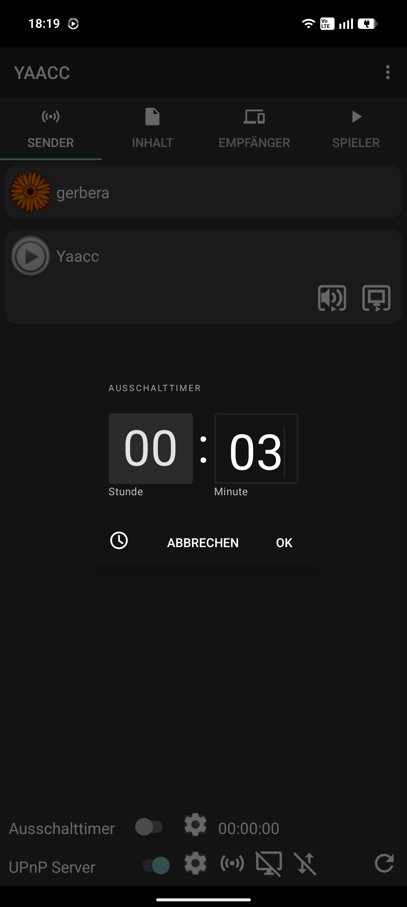

<!-- markdownlint-configure-file {
    "first-line-h1": false
} -->

* TOC
{:toc}

# Features

* UPnP/DLNA Server - share files of your device in the network
* UPnP/DLNA Client - receive media from other devices on your device
* UPnP/DLNA Controller - control media renderer in the network
* Control multiple media renderer
* Allow download files to the device
* Allow sharing of http and https links and sending them to the current media renderers
* Use your device as an proxy if your media renderer can't process https media URLs
* Download files to the device for offline access
* A Shutdown timer stops the running players and the app after a given time
* Sort browsed content by name or date, ascending or descending
* Android TV support (leanback launcher)
* Two layouts: the classic tabs (default) or a single screen with a mini-player, chosen in the settings

# Usage

YAACC has two layouts. The classic layout with tabs is the default. A new
single-screen layout is available in the settings under *Appearance* >
*Layout*: choose "Classic (tabs)" or "New (single screen)". The change takes
effect when you return from the settings to the app screen; running players keep
playing. This page describes the classic layout first, see
[New layout](#new-layout-single-screen) for the single screen.

In the classic layout all UPnP/DLNA servers in your network are listed on the
first screen. Select one and the app will automatically switch to the content tab.
It allows to browse the content provided by the selected server.

{:height="30%" width="30%"}

Before playing content make sure you have chosen a receiver, on
the receiver tab (in the new layout: in the device sheet that opens from the
receiver bar at the bottom of every screen), see
[Receiver controls](#receiver-controls).
Receivers are either UPnP/DLNA media renderers in your network or the
android device itself.

{:height="30%" width="30%"}

Normally senders and receivers will appear automatically.
If not you can use the refresh button at the bottom of
the sender and receiver tab to trigger a new search for devices
(in the new layout: the refresh button in the "Servers" header).

## New layout (single screen)

Switch to it with *Settings* > *Appearance* > *Layout* > "New (single screen)".
Switching back to "Classic (tabs)" works the same way. The classic layout stays
the default, also on Android TV; the new layout has not been checked with a TV
remote yet. There are no tabs. The screen shows one level at a time:

* **Servers** is the top level. The "Servers" header has the refresh button to
  search for devices again. Below it all UPnP/DLNA servers in your network are
  listed; the YAACC entry has the live streaming buttons (see
  [Live streaming](#live-streaming-android-10)). At the bottom are the YAACC
  server switch with the button for the server settings, and the icons showing
  whether the device acts as media provider, media renderer or proxy
  (see [Media server](#media-server)). These bottom controls exist only on
  this level.
* **Content**: tap a server to browse it, see [Content browsing](#content-browsing).
  The arrow in front of the path and the system back button go back one step at a
  time: from a folder to the parent folder, from the root of a server to the
  server list, and from the server list the app exits.
* **Toolbar**: the timer symbol is the [shutdown timer](#shutdown-timer) and its
  only entry. While a timer runs, a tap stops it and the remaining time is shown
  next to the symbol. Otherwise a tap opens the duration picker; confirming a
  duration above 0 starts the timer. The overflow menu has the settings, the log
  and the about page, and the exit button quits the app.
* **Receiver bar**: at the bottom of every level. It shows the selected
  receivers; tap it to open the device sheet, see
  [Receiver controls](#receiver-controls).
* **Mini-player**: directly above the receiver bar. It shows every running player
  as one compact row: the album art when available, the title, the name of the
  receiver it plays on, and the buttons previous, play/pause, next and stop. Tap a
  row itself to open that player's screen. The rows are in the same order as the
  players in the device sheet (the one started first is on top). Up to about three
  rows are visible; with more players the list scrolls inside the mini-player. The
  mini-player is hidden when no player is running.

## Content browsing

The content browsing has a bread crumb on the top.
Behind each content entry different symbols are showing the possible actions:

* add an item to the playlist
* download the item
* play the item
* play all items on the same directory level

The bread crumb starts with the name of the selected server. The arrow in front
of it goes up one folder (in the new layout it also leaves the server at its
root folder).

In the classic layout the bottom of the screen shows two lines: the name of the
selected server and the names of the selected receivers (separated by "; "),
each with its icon. They only display the current selection; choose the
receivers on the receiver tab. Playing while no receiver is selected shows a
message asking you to select one there.

In the new layout the receiver bar at the bottom shows the names of the selected
receivers; tap it to open the device sheet. If you start playing an item while no
receiver is selected, the device sheet opens instead so you can choose one;
then tap play again.

A toggle in the folder header lets you sort the current folder by name or date,
ascending or descending. yaacc uses the server's own sort support when browsing
a UPnP/DLNA server that offers it, falling back to sorting the results itself
otherwise. The chosen sort order is remembered across app restarts.

{:height="30%" width="30%"}

## Playing content

YAACC is able to control multiple players at the same time.
For example you are able to stream an image show with background music
on your device, starting a movie on a TV or play music on a
smart speaker at the same time.

Each player is displayed in the player tab (classic layout). The new layout has
no player tab: every running player has a row in the mini-player and is listed in
the device sheet under the receiver it plays on. Depending on the content type
and if the content is played by YAACC itself or a network device, the player ui differs.

{:height="30%" width="30%"}

YAACC includes a player for music and image shows.
Videos are played using a third parties app on the device.
The video app will start automatically, if video content is selected for playing

{:height="30%" width="30%"}

{:height="30%" width="30%"}

### Receiver controls

The receiver tab shows all available UPnP/DLNA renderers in your network, including your device.
Each renderer displays:

* Current playback status (PLAYING badge when active)
* Track title and album art (when available)
* Play/pause/stop controls
* Volume control
* Mute button

{:height="30%" width="30%"}

You can control playback directly from the receiver tab without opening the player view.
The controls work for both local playback and remote UPnP devices.

In the new layout there is no receiver tab: tap the receiver bar at the bottom of any
screen (or select it with the D-pad) to open the device sheet. The classic layout does not
have the sheet; use the receiver tab and the player tab there.
The sheet lists every receiver with its checkbox, status, play/pause/stop, volume and mute controls,
and under each receiver the YAACC players currently running on it, in the order they were started.
Players on a device that is no longer in the receiver list are shown at the end.
Tap a player to open its player view.

* On phones and tablets the sheet opens at half height. Drag it up for full height;
  drag it down or press Back to close it.
* On Android TV, or when using a D-pad, it opens at full height with the first receiver focused.
* While the sheet is open, receiver status and the list of running players update live.
  Status polling stops when the sheet is closed or the app goes to the background.

### Lock screen controls

When playing media locally, YAACC provides lock screen controls:

* Play/pause/stop buttons
* Next/previous track
* Track metadata display
* Album art
* Hardware volume buttons control playback volume

## Live streaming (Android 10+)

YAACC can stream your device's screen and system audio to UPnP/DLNA renderers in your network.

### System audio streaming

Stream all audio playing on your device to network speakers or receivers:

* Captures system audio (music, podcasts, games, etc.)
* 44.1kHz stereo, high quality
* Works with most UPnP audio renderers
* Multiple simultaneous clients supported

**Note:** Some apps may block audio capture (DRM-protected content like Spotify, YouTube Premium).

### Screen casting

Stream your device's screen to TVs or displays:

* 720p video at 15fps
* MJPEG format for broad compatibility
* Works in web browsers and some UPnP video players
* Useful for presentations and screen sharing

### Enabling live streaming

1. Go to the Server tab (in the new layout: the Servers screen)
2. Find your local device in the list
3. Tap the audio or video button
4. Grant MediaProjection permission when prompted
5. The stream appears in the "Live Streams" folder

Access streams via UPnP or directly:
* Audio: `http://<device-ip>:49157/live/audio`
* Video: `http://<device-ip>:49157/live/video`

## Storage Access Framework (SAF)

YAACC supports browsing files from external storage, USB drives, and SD cards using Android's
Storage Access Framework. This allows sharing media from any storage location accessible on your device.

### Configuring SAF folders

In the server control view, you can add SAF folders to share:

1. Tap "Add SAF folder"
2. Select the folder using Android's file picker
3. Grant permission when prompted
4. The folder appears in the server content directory

{:height="30%" width="30%"}

### Performance optimization

YAACC caches metadata (duration, MIME type, file size) for faster browsing:

* First browse: Extracts metadata from files
* Subsequent browses: Uses cached data
* Cache persists across app restarts
* Clear cache button available in server control view

The cache significantly improves browsing performance, especially for large media collections.

## Battery optimization

YAACC includes several battery-saving features:

### Smart WiFi lock management

The WiFi lock is only held when actually needed:

* Released when app is backgrounded (if server/renderer disabled)
* Released when no active streaming
* Automatically re-acquired when needed

### Smart foreground service

The player service intelligently manages foreground state:

* Foreground only when actively playing media
* Stops foreground when paused (notification hidden)
* Service stops completely when no players active

## Modern architecture

YAACC uses modern Android APIs for better performance and system integration:

* **Media3/ExoPlayer** - Modern media playback engine (replaces deprecated MediaPlayer)
* **MediaSession** - System-wide media controls and lock screen integration
* **Improved UPnP stack** - Enhanced reliability and network state handling
* **AudioPlaybackCapture** - System audio streaming (Android 10+)
* **MediaProjection** - Screen casting support

## Media server

YAACC includes a media server service, which has to be enabled separately.
A switch for this is located at the bottom of the server list tab
(in the new layout: at the bottom of the Servers screen).

{:height="30%" width="30%"}

Depending on the configurations for the server in the settings,
the server service is used as media provider, media renderer or proxy.
The icons behind the server switch are showing which service is activated.

## Media provider

If the device is used as media provider, media files stored on the device
are accessible for other UPnP/DLNA devices in you network.

The shareable folders have to be configured using the server control view.
All included files and folders are accessible for other devices in your network.

{:height="30%" width="30%"}

The server control view is accessible through the settings button next to the server
switch at the bottom of the server list, or the YAACC server service notification.

## Media renderer

This service allows your device acting as an media renderer. Therefore the
device can be controlled by other UPnP/DLNA controllers in your network
and receive and play media from UPnP/DLNA servers.

## Media proxy

The proxy service is used in the context of sharing URLs with YAACC and
playing the URL on a UPnP/DLNA device in your network. Normally the
URL will directly passed to the rendering device. Sometimes the rendering
device is not able to play https URLs. Therefore we need to get rid of the
encryption and provide the content with an unencrypted http URL.
For this the proxy service can be used. In that case the URL shared with
YAACC will not directly passed to the rendering device. YAACC generates a
new http based URL which points to YAACC and send the to the receiver.
When the content is played YAACC fetches the data from the origin through the
encrypted https connection an passed the content unencrypted through the http
connection to the rendering device. Because the content then travels unencrypted
to the rendering device, enable the proxy only on a network you trust.

Only a link that starts with `http://` or `https://` can be shared with YAACC, and the
shared text should be just that link. Shared files, other kinds of links and shared text
longer than 2048 characters are ignored.

## Shutdown timer

The shutdown timer stops all running players and the app after a certain time.
The timer is settable and can be enabled at the bottom of the server list tab and the remaining time
is displayed. In the new layout the timer is the symbol in the toolbar instead: tap it
while a timer runs to stop it (the symbol shows the remaining time); otherwise a tap opens the
duration picker, and confirming a duration above 0 starts the timer.

{:height="30%" width="30%"}

{:height="30%" width="30%"}

| [Screenshots](screenshots/) | [Settings](settings/) |  [About](about/) | [Code](doxygen/html/inherits.html) | [Legal Notice (Impressum)](https://schoenesnetz.de/pages/disclamer_license/about.en.html) | [Privacy Policy](privacy.html)

