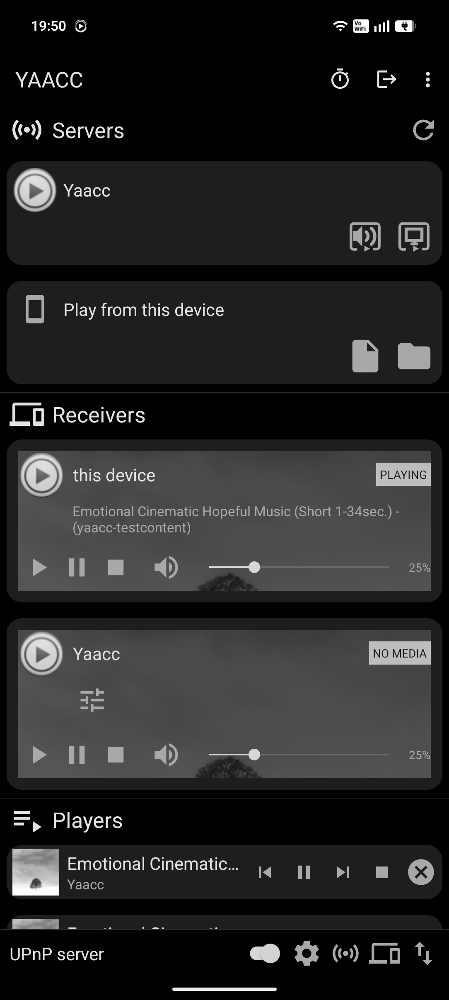
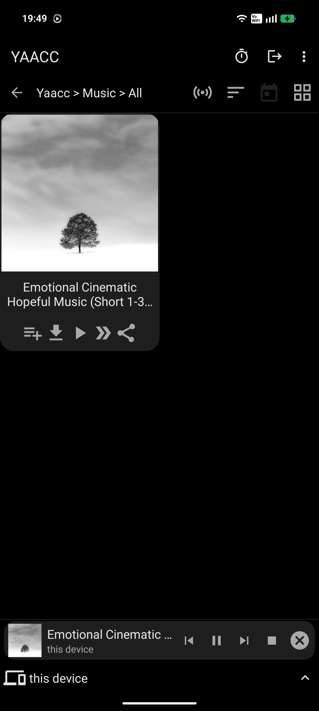
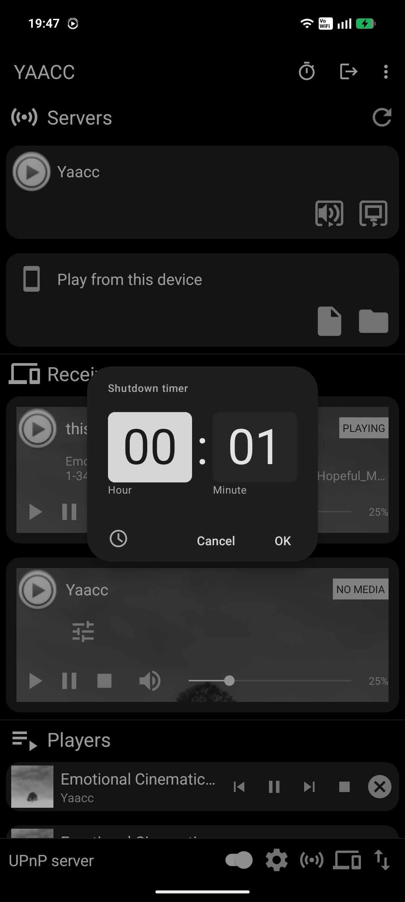

<!-- markdownlint-configure-file {
    "first-line-h1": false
} -->

* TOC
{:toc}

# Features

* UPnP/DLNA Server - share files of your device in the network
* UPnP/DLNA Client - receive media from other devices on your device
* UPnP/DLNA Controller - control media renderer in the network
* Control multiple media renderer
* Link Yamaha MusicCast devices into a group, set the group volume, control their own sources (now playing, tuner, presets) and change device settings, see [MusicCast devices](#musiccast-devices)
* Play music on OpenHome devices, which keep the playlist themselves, and let OpenHome control points play on YAACC, see [OpenHome](#openhome)
* Control Snapcast multi-room servers (each group is a receiver: group volume and mute, per-client volume, latency and name, the stream of a group, linking and unlinking clients) and, as an experimental option, play music from the phone to a Snapcast group, see [Snapcast](#snapcast)
* Allow download files to the device
* Share a link (http or https) or one audio, video or image file from another app to YAACC and play it on the receivers you pick, see [Sharing to YAACC](#sharing-to-yaacc)
* Pick files or a folder of your device and play them on the receivers you pick without serving them constantly, see [Playing files from this device](#playing-files-from-this-device)
* Use your device as an proxy if your media renderer can't process https media URLs
* Download files to the device for offline access
* A Shutdown timer stops the running players and the app after a given time
* Sort browsed content by name or date, ascending or descending
* Android TV support (leanback launcher)
* Two layouts: the classic tabs or a single screen (the default of a fresh install) with servers, receivers and the running players on one page, chosen in the settings
* Share an item you browse (the file or its link) with other apps, see [Content browsing](#content-browsing)

# Usage

YAACC has two layouts. A fresh install and an installation updated from a version without this setting start in the new layout; a layout you chose before stays. You switch
in the settings under *Appearance* >
*Layout*: choose "Classic (tabs)" or "New (single screen)". The change takes
effect when you return from the settings to the app screen; running players keep
playing. This page describes the classic layout first, see
[New layout](#new-layout-single-screen) for the single screen.

In the classic layout all UPnP/DLNA servers in your network are listed on the
first screen. Select one and the app will automatically switch to the content tab.
It allows to browse the content provided by the selected server.

{:height="30%" width="30%"}

Before playing content make sure you have chosen a receiver. In the classic
layout you tick receivers on the receiver tab. In the new layout there is no
persistent selection: every time you play, the "Play on…" list asks for the
receivers, see [Choosing receivers](#choosing-receivers-new-layout) and
[Receiver controls](#receiver-controls).
Receivers are either UPnP/DLNA media renderers in your network or the
android device itself.

{:height="30%" width="30%"}

Normally senders and receivers will appear automatically.
If not you can use the refresh button at the bottom of
the sender and receiver tab to trigger a new search for devices
(in the new layout: the refresh button in the "Servers" header).

## New layout (single screen)

Switch to it with *Settings* > *Appearance* > *Layout* > "New (single screen)".
Switching back to "Classic (tabs)" works the same way. A fresh install starts in
the new layout (also on Android TV, where it has not been checked with a TV
remote yet); an updated installation without a stored layout starts in the new layout.
There are no tabs. The screen shows one level at a time:

* **Servers, receivers and players** is the top level, one list in three sections with a
  thin line between them. The "Servers" section (broadcast icon in front of the header) lists
  all UPnP/DLNA servers in your network with the card "Play from this device" below them; the YAACC
  entry has the live streaming buttons (see [Live streaming](#live-streaming-android-10)). Its header has
  the refresh button to search for devices again (one search finds servers and receivers). The
  "Receivers" section (devices icon) lists every receiver with the same rows and controls as the
  device sheet, see [Receiver controls](#receiver-controls) (the players that run on a receiver are in the
  "Players" section, not under the receiver as in the sheet); while only this phone is listed it says that no other
  receiver was found yet. The "Players" section lists every running player as one compact row, like
  the mini-player below the content (see below); it is only there while a player runs. The rows update
  live while this level is shown. This level has neither the receiver bar nor the mini-player at the
  bottom, because the sections show the same. At the bottom of the screen are the YAACC
  server switch with the button for the server settings, and the icons showing
  whether the device acts as media provider, media renderer or proxy
  (see [Media server](#media-server)). These bottom controls exist only on
  this level.
* **Content**: tap a server to browse it, see [Content browsing](#content-browsing).
  The arrow in front of the path and the system back button go back one step at a
  time: from a folder to the parent folder, from the root of a server to the
  server list, and from the server list the app goes to the background like any
  other app (it keeps running; the exit button and the idle close below end it). The server button in the
  header of the content (the broadcast icon, the same one as in front of the "Servers"
  header; a long press shows its name) shows the server list at once from any folder
  depth, so you can change the server without going back folder by folder.
* **Toolbar**: the timer symbol is the [shutdown timer](#shutdown-timer) and its
  only entry. While a timer runs, a tap stops it and the remaining time is shown
  under the title of the toolbar. Otherwise a tap opens the duration picker; confirming a
  duration above 0 starts the timer. The overflow menu has the settings, the log
  and the about page, and the exit button quits the app.
* **Receiver bar**: at the bottom of the content of a server (the top level has the Receivers section instead). It shows the names of the
  receivers that are playing something right now (a paused player counts), or
  "No receiver playing". It does not show a selection. Tap it to open the device
  sheet, see [Receiver controls](#receiver-controls).
* **Mini-player**: directly above the receiver bar, below the content of a server (the top level has the Players section instead). It shows every running player
  as one compact row: the album art when available, the title, the name of the
  receiver it plays on, and the buttons previous, play/pause, next, stop and exit (stop only stops the
  playback, exit removes the player). Tap a row itself to open that player's screen. The rows are in the same order as the
  players in the device sheet (the one started first is on top). Up to about three
  rows are visible; with more players the list scrolls inside the mini-player. The
  mini-player is hidden when no player is running.

## Content browsing

The content browsing has a bread crumb on the top.
Behind each content entry different symbols are showing the possible actions:

* add an item to the playlist
* download the item
* play the item
* play all items on the same directory level
* share the item with another app: the symbol (and the share entry in the menu of the image viewer) offers *Share file*, which copies the item to the cache of YAACC and hands it to the app you choose (so it works also for a server that is only reachable in your network), and *Share link*, which hands over the address of the item

The bread crumb starts with the name of the selected server. The arrow in front
of it goes up one folder (in the new layout it also leaves the server at its
root folder).

In the classic layout the bottom of the screen shows two lines: the name of the
selected server and the names of the selected receivers (separated by "; "),
each with its icon. They only display the current selection; choose the
receivers on the receiver tab. Playing while no receiver is selected shows a
message asking you to select one there.

In the new layout the receiver bar at the bottom of the content shows the receivers that are
playing; tap it to open the device sheet. Playing does not use a stored selection:
play, play all, tapping an item, and add to playlist first open the "Play on…"
list, see [Choosing receivers](#choosing-receivers-new-layout).

A button in the folder header switches between a list and a grid of cards (the
same entries and the same buttons); the cards are the default of a fresh install
and your choice is remembered. In landscape the cards are laid out in several
columns.

A toggle in the folder header lets you sort the current folder by name or date,
ascending or descending. yaacc uses the server's own sort support when browsing
a UPnP/DLNA server that offers it, falling back to sorting the results itself
otherwise. The chosen sort order is remembered across app restarts.

{:height="30%" width="30%"}

### Choosing receivers (new layout)

In the new layout the receiver is chosen for each action:

1. Tap play, play all, an item row, or add to playlist. A sheet titled "Play on…"
   opens with every receiver, including this device, and a checkbox per row.
   The receivers of your last confirmed choice are ticked, so the usual receiver
   is one tap away; on the very first use nothing is ticked.
2. Tick one or more receivers and tap "OK". With nothing ticked "OK" only shows
   "Choose at least one receiver." and the list stays open.
3. YAACC starts the playback on exactly those receivers. Afterwards nothing is
   selected again, so the next action asks again. The receiver bar shows the
   receivers that are playing.

"Cancel", the back button, a tap outside the list or dragging it down close it
and change nothing: nothing starts. While a previous action is still starting, a
short message says so and the list does not open.

"Add to playlist" adds the item to the playlists of the chosen receivers that
already have a player. Only if none of the chosen receivers has a player yet,
YAACC starts a new player on each chosen receiver. A chosen receiver without a
player is skipped while another chosen receiver already plays.

The classic layout keeps its way: tick receivers on the receiver tab, they stay
selected, and the bottom of the content tab shows two read-only lines (the
selected server and the selected receivers).

## Playing content

YAACC is able to control multiple players at the same time.
For example you are able to stream an image show with background music
on your device, starting a movie on a TV or play music on a
smart speaker at the same time.

Each player is displayed in the player tab (classic layout). The new layout has
no player tab: every running player has a row in the mini-player (on the top level: in the Players section) and is listed in
the device sheet under the receiver it plays on. Depending on the content type
and if the content is played by YAACC itself or a network device, the player ui differs.

{:height="30%" width="30%"}

YAACC includes a player for music and image shows.
Videos are played using a third parties app on the device.
The video app will start automatically, if video content is selected for playing

{:height="30%" width="30%"}

{:height="30%" width="30%"}

### Receiver controls

The receiver tab shows all available UPnP/DLNA renderers in your network, including your device.
Each renderer displays:

* Current playback status (PLAYING badge when active)
* Track title and album art (when available)
* Play/pause/stop controls
* Volume control
* Mute button

{:height="30%" width="30%"}

You can control playback directly from the receiver tab without opening the player view.
The controls work for both local playback and remote UPnP devices.

In the new layout there is no receiver tab: the top level lists the receivers below the servers, and the receiver bar
below the content of a server (or selected with the D-pad) opens the device sheet. The classic layout does not
have the sheet; use the receiver tab and the player tab there.
The sheet is titled "Receivers". It lists every receiver with its status, play/pause/stop, volume and mute controls,
and under each receiver the YAACC players currently running on it, in the order they were started.
It has no selection checkboxes: receivers are chosen when you start something,
see [Choosing receivers](#choosing-receivers-new-layout).
Players on a device that is no longer in the receiver list are shown at the end.
Tap a player to open its player view.

* On phones and tablets the sheet opens at half height. Drag it up for full height;
  drag it down or press Back to close it.
* On Android TV, or when using a D-pad, it opens at full height with the first receiver focused.
* While the sheet is open, receiver status and the list of running players update live.
  Status polling stops when the sheet is closed or the app goes to the background.

### Repeat and shuffle

Every player has its own repeat and shuffle buttons: the music player, the player of a
receiver (AVTransport) and the player for videos and mixed content have them next to the
previous/next buttons (the image viewer in its menu bar).

* **Repeat** cycles *off* (the playlist is played once, then the player stops), *all*
  (starts again with the first item after the last one) and *one* (the same item is
  played again and again; the next and previous buttons still skip to another item).
  The symbol shows a "1" for repeat one; a symbol drawn half transparent means off.
* **Shuffle** plays the items in a random order, every item once per round. Switching
  it on or off while playing keeps the current item; previous goes back through the
  order that was played.

With shuffle on, the playlist dialog lists the items in the order they will play, with the playing item marked at its place; dragging an item changes the play order and leaves your list as it is, deleting removes the item from both. Without shuffle it shows the list as before.

The settings *Repeat for new players* and *Shuffle for new players* (see [Settings](settings.html); they
were called *replay playlist* and *shuffle music*) only give the mode a new player starts with. They are not a switch
for all players: every player, also one that Home Assistant controls, has its own mode. A change with the buttons belongs to that player
only: it is not written to the settings and ends with the player. The mode of the
player of YAACC's own media renderer can also be changed by a control point
(UPnP *SetPlayMode*, for example the repeat and shuffle services of Home Assistant), and a change
with the buttons is reported back to the control point.

### Lock screen controls

When playing media locally, YAACC provides lock screen controls:

* Play/pause/stop buttons
* Next/previous track
* Track metadata display
* Album art
* Hardware volume buttons control playback volume

## Live streaming (Android 10+)

YAACC can stream your device's screen and system audio to UPnP/DLNA renderers in your network.

### System audio streaming

Stream all audio playing on your device to network speakers or receivers:

* Captures system audio (music, podcasts, games, etc.)
* 44.1kHz stereo, high quality
* Works with most UPnP audio renderers
* Multiple simultaneous clients supported

**Note:** Some apps may block audio capture (DRM-protected content like Spotify, YouTube Premium).

### Screen casting

Stream your device's screen to TVs or displays:

* 720p video at 15fps
* MJPEG format for broad compatibility
* Works in web browsers and some UPnP video players
* Useful for presentations and screen sharing

### Enabling live streaming

1. Go to the Server tab (in the new layout: the Servers screen)
2. Find your local device in the list
3. Tap the audio or video button
4. Grant the microphone permission (needed to capture the device audio; the app records no microphone sound) and then the screen capture permission when prompted. If you deny either, the stream buttons stay off
5. The stream appears in the "Live Streams" folder

Access streams via UPnP or directly:
* Audio: `http://<device-ip>:49157/live/audio`
* Video: `http://<device-ip>:49157/live/video`

## Storage Access Framework (SAF)

YAACC supports browsing files from external storage, USB drives, and SD cards using Android's
Storage Access Framework. This allows sharing media from any storage location accessible on your device.

### Configuring SAF folders

In the server control view, you can add SAF folders to share:

1. Tap "Add SAF folder"
2. Select the folder using Android's file picker
3. Grant permission when prompted
4. The folder appears in the server content directory

{:height="30%" width="30%"}

### New files and folders

New files and folders inside an added SAF folder appear by themselves; you do not have to add the folder again. While the local server runs,
YAACC looks at the added folders (and at the folders your control points opened lately) every 30 seconds and tells the connected control points when something changed,
at most once every 15 seconds, so a download that is still running does not flood them. A new file or folder is therefore shown after about 30 to 45 seconds.
If a control point (media player, Home Assistant ...) still shows the old content after that, refresh the folder there or open it again; not every control point reacts to the message.
Changing which folders are ticked in the server settings is not announced; refresh the control point after that.

### Performance optimization

YAACC caches metadata (duration, MIME type, file size) for faster browsing:

* First browse: Extracts metadata from files
* Subsequent browses: Uses cached data
* Cache persists across app restarts
* Clear cache button available in server control view

The cache significantly improves browsing performance, especially for large media collections.

## Battery optimization

YAACC includes several battery-saving features:

### Smart WiFi lock management

The WiFi lock is only held when actually needed:

* Released when app is backgrounded (if server/renderer disabled)
* Released when no active streaming
* Automatically re-acquired when needed


### Smart foreground service

The player service intelligently manages foreground state:

* Foreground only when actively playing media
* Stops foreground when paused (notification hidden)
* Service stops completely when no players active


## Modern architecture

YAACC uses modern Android APIs for better performance and system integration:

* **Media3/ExoPlayer** - Modern media playback engine (replaces deprecated MediaPlayer)
* **MediaSession** - System-wide media controls and lock screen integration
* **Improved UPnP stack** - Enhanced reliability and network state handling
* **AudioPlaybackCapture** - System audio streaming (Android 10+)
* **MediaProjection** - Screen casting support

## MusicCast devices

YAACC recognizes receivers that are Yamaha MusicCast devices and offers a few extra controls on their rows (in the device sheet of the new layout and on the receiver tab of the classic layout). Other receivers are not changed in any way. A device counts as a MusicCast device when its UPnP description announces the address of the Yamaha Extended Control (YXC) interface; nothing is configured by hand. YAACC only works with devices that are already set up in your network (with the manufacturer's app); it does not add a device to the network or remove one.

### The row

Besides the usual status and controls, the row of a MusicCast device shows whether it is on, in standby or not reachable, its current input, and, while it is in a group, "Linked with <name>" (a group leader shows the names of its members). The row follows the device within a moment, also when you change something with another app or the remote control: the devices report changes by themselves, and YAACC reads them completely every 30 seconds in addition.

**The power button.** A device that offers power (the main zone lists `power` in its features; the captured devices all do) has a power button in the title line of its card, next to the check box. The symbol is full when the device is on and dimmed in standby or when its state is not known, and it says its state aloud ("Power: Kitchen", "On", "Standby" or "State unknown"). A tap reads the state of the device again first and then does the opposite of what the device says now (so a card that was a moment behind does not switch the wrong way), waits a moment and reads it once more; the card follows the device's own events. While the change runs the button is disabled; a second tap is ignored. If the device does not answer, does not say whether it is on, or does not accept the change, a message says so and nothing is changed. Devices that do not list `power`, and a device that has not told its features yet, show no button. The same button is on the cards of OpenHome devices (see [OpenHome](#openhome)).

### The device's own sources

While a MusicCast device plays something of its own (net radio, a streaming service, a server on the network, the FM or DAB tuner) and YAACC plays nothing on it, the row shows a second line with what is playing (station, title, artist, or the frequency or service of the tuner) and adds controls for that source. Only what the device reports for the current source is shown:

* Play, pause and stop on the row work on the device's source. While YAACC plays or has paused something on the device, they stay with YAACC's own playback and the controls of the source are hidden.
* Previous, next, repeat and shuffle appear when the source supports them (net radio, for example, has only play and stop).
* Tuner: the two buttons step the FM frequency by one step; a long press scans to the next station (a tap stops the scan). A switch with both names, FM and DAB, changes the band; with DAB the two buttons select the previous or next service.
* The star button opens a sheet with the device's presets (the stored stations of the net source and of the tuner) and its recently played entries. Empty slots are not shown; a tap recalls the entry, which also switches the device to its input.

The controls act on the device only after YAACC has read its current state again, so a stale display does not send a wrong command.

### Linking devices

### Linking devices

The link button on the row opens a list of the other MusicCast devices in the same style as the receiver picker.

* Tick the devices that should play together with this one and confirm. This device becomes the group leader and the ticked devices follow it; they play in sync.
* On the row of a leader the button opens the list again with its members ticked: tick more devices to add them, untick some to remove them, untick all to end the group.
* The button is disabled on a device that is a member of someone else's group; change the group on the leader's row. Linking is also refused for devices that are already in another group (they are listed as "in another group") or that do not answer.
* A device that is removed from a group is put back on the input it used before it was linked, if YAACC has seen that input. If YAACC never saw an earlier input, the device stays on the link input (the row says "No group, still on the link input") and you choose its input in the device settings.
* Changing a group interrupts what is playing on the devices concerned.

### Playing on a group

When you play on a device that is a member of a group, YAACC sends the media to the leader of the group instead and tells you so ("Kitchen is linked with Living room. Playing on Living room."); the members play in sync with the leader. This also applies to files and folders picked with [Playing files from this device](#playing-files-from-this-device). In the receiver picker such a member is marked "plays via <leader>". If the leader of a group cannot be determined clearly, YAACC does not guess and asks you to play on the leader.

### Volume

The volume slider and the mute button of a MusicCast device use the device's own interface, because the generic UPnP volume control does not work for devices that are in a group. Every device keeps its own volume. The devices do not pass the volume of the leader on to the members by themselves. A leader therefore has an additional slider "Group volume": it shows the average of all members and moves every member by the same number of percentage points while you drag (each member stays within 0 to 100 %; dragging back restores every member's own level).

### Device settings

The settings button on the row opens a sheet with what the device reports as changeable: power, input, sound program, sleep timer, a three-band equalizer, the brightness of the display, the automatic standby and the link settings (audio delay, audio quality). Entries a device does not offer are not shown, and the sheet only offers the values the device reports. The sheet says so when the settings cannot be read or changed.

### Limits

* MusicCast devices only; no MusicCast account, streaming-service login, network or firmware setup, clock or alarm.
* Play, pause and stop on the row are those of the UPnP renderer while YAACC plays on the device; otherwise they control the device's own source. Searching and choosing content inside a streaming service or the net radio directory is not part of YAACC; use the presets or the manufacturer's app for that.
* Updates reach the app as UDP messages from the device to the phone. If the Wi-Fi isolates devices from each other, or the phone's Wi-Fi is in power save, they may not arrive; the row is then updated by the 30 second read.
* YAACC talks to a device only at the address it announced in your network, and shows everything a device sends as plain text.

Yamaha and MusicCast are trademarks or registered trademarks of Yamaha Corporation. OpenHome is the name of an open specification for networked music players and is used only to describe compatibility. YAACC is an independent project and is not affiliated with, authorized or endorsed by Yamaha.

## Snapcast

[Snapcast](https://github.com/snapcast/snapcast) is an open source multi-room audio system: a server (snapserver) sends audio streams with a common buffer to any number of clients (snapclients) that play them in sync. The clients are organised in groups, and a group plays one stream. YAACC works with a Snapcast server that already runs in your network, in two ways:

* **Control.** Every group of a server appears among the receivers, and you control it from there: group volume and mute, the volume, latency and name of every client, the stream a group plays, and which clients belong to the group.
* **Play (experimental, off by default).** YAACC plays music from the phone to a group: it adds a stream to the server while you play and sends the audio into it.

YAACC is never a Snapcast server, and the phone is a Snapcast client only when you switch on the experimental client (see [This phone as a Snapcast client](#this-phone-as-a-snapcast-client-experimental)): otherwise the phone does not play a Snapcast stream and the clients of the group are other devices. One receiver is one Snapcast group, and a group always lives on one server: YAACC has no way to move a client to another server.

The Snapcast support is new: the control screens were checked against the test rig and in automated tests but not yet on a phone, and the play option has not been tried with real speakers; see [Snapcast limits](#snapcast-limits) and [Snapcast security](#snapcast-security).

### What you need

* A snapserver that your phone can reach in the network, with its TCP control interface switched on (port 1705 unless the server uses another one). A server that has authorization (a login) switched on is not supported. Neither the control port nor the stream ports are protected, so keep them inside a network you trust (or behind a VPN) and do not type in the public address of a server.
* For the play option also the ports 4953 to 4962 of the server: YAACC asks the server to open one of them for the audio and connects to it (a firewall on the server must let the phone through).
* For finding a server by itself the server must announce itself in the network (mDNS, for example through Avahi); otherwise type its address in.
* Tested with: Snapcast 0.35.0 (a build of its development sources from November 2026) in the Docker test rig of this project, one snapserver and two snapclients without sound output, see [The test rig](#the-snapcast-test-rig). Other versions have not been tested. The app itself has not been tried with a phone and real speakers yet (that is why the play option is experimental).

### Adding servers

Open *Settings* > *Snapcast (experimental)*:

* **Snapcast servers** opens the list of servers. Type a host name or an IP address with an optional port (`snapserver.local`, `192.168.1.20`, `192.168.1.20:1705`; the default port is 1705; an IPv6 address needs brackets when a port follows, `[fd00::5]:1705`; IPv4 numbers are written without leading zeros) and tap *Add*. Nothing but host and port is accepted: a text with `@` (user name and password) or a web address is refused, because YAACC stores no credentials. Up to 16 servers are listed in total; a server you typed in, or one that was found, and the same address twice are one entry. *Remove* removes a typed-in server and the groups of that server from your receiver selection; a server that is announced in the network right now cannot be removed (clear *Find Snapcast servers* instead).
* **Find Snapcast servers** (**on by default**) searches the local network for servers that announce themselves. What it does while the checkbox is on: it sends mDNS queries on the network (Wi-Fi, a cable or a VPN: whatever network the phone is on; it holds the multicast lock the system needs for that) only while a page that shows Snapcast receivers or the *Snapcast servers* window is open (this includes the first screen of a fresh install: the first *Servers* tab shows the receivers section, so the search starts there without a tap), and the receivers page then connects (control connection) to every server that announces itself in your network. **The announcements are not authenticated:** any device in the network can announce a server, so a look-alike "Living room" is possible (the first line of the group row shows the server's address). Clear the checkbox in networks you do not trust. Only servers at addresses of the local network (private, link-local or loopback addresses) on a port of 1024 or higher are accepted. With the checkbox off only the servers in the list (and the remembered ones, see below) are used and nothing is scanned. An installation that never changed the checkbox has it on.

**If the search does not find your server.** The search looks for the service that a snapserver announces for its control port: `_snapcast-ctrl._tcp` (Snapcast 0.33 and newer) and `_snapcast-tcp._tcp` (0.32 and older, which many distribution packages still have). It also listens for `_snapcast._tcp` (the stream port, every version), only to tell in the report below that a server announces itself but not its control port; such a server is never listed from that announcement. A server that does not announce itself at all can not be found: that is the case when mDNS or Avahi is off on the server (the Docker test rig has it compiled out) or when the router or access point does not pass multicast between the phone and the server. Then add the server by address.

Below the list of servers, *Snapcast servers* shows the **discovery report**: the state of the switch, of the Wi-Fi, of the multicast permission and lock, what is browsed and how many services each type reported (with the names of the system's failure codes), the servers listed, and the last events with their time. *Copy report* puts it on the clipboard, to paste into a report. It names the servers found and their addresses in your network and carries the manufacturer, model and Android API level of the phone; look at it before you paste it somewhere. On Android 13 and newer the copy is marked as sensitive, so the system keeps it out of the preview of the pasted text. While the window is open and the checkbox is on, the network is searched, so the report is live. Its last line, *reading*, says what the facts mean: for example that the switch is off, that the phone is not on Wi-Fi, that the system reports no Snapcast service at all (the server does not announce itself, or its announcements do not reach the phone), or that a server was found.

A server that holds a receiver you selected is remembered (its address only) so that the selection survives an app restart; it is listed again without a scan, also when the discovery is off. With the discovery on, a remembered server that is not announced any more disappears after the receivers have been shown for about half a minute.

### Groups as receivers

Each group appears in the receivers (the top-level page, the device sheet and the receiver tab of the classic layout) as *group name (Snapcast)*; a group without a name takes the name of its first client (its host name if that has no name either, and the label "Snapcast group" if there is nothing to take), and a group of a server that is not reachable gets *(Snapcast, offline)*. The row works like the other receiver rows, with these differences:

* The first line shows the server (its address), so you can see which server a group belongs to; the second line shows the stream the group plays, how many of its clients are connected (*Clients connected: 2 of 3*), the volume and *muted*. *server unreachable* means that the connection to the server is down (the group stays listed with what was known last, and is not removed at once); *stream unavailable* means that the stream of the group is not in the server's list or is disabled.
* The slider and the mute symbol of the row are the volume and the mute of the **group**; the mute is the speaker / muted-speaker symbol of the other receiver cards (also in the group sheet, for the group and for each client; it has a spoken description and says whether it is muted). Snapcast has no group volume of its own: the slider shows the average of the connected clients and moves each of them by the same number of points while you drag (each stays within 0 and 100, and dragging back restores their own levels). The mute is the server's group mute.
* The **link icon** of the row (the same icon as on a MusicCast row) opens the sheet that links clients to the group and unlinks them: it lists every client of the server, the members of the group are checked, and *OK* makes the group consist of exactly the checked clients. A checked client of another group moves into this group (the list says when its group would end because it loses its last client), an unchecked member leaves the group and gets a group of its own (it is not disconnected), and a client that is not connected can be linked too (marked *offline*). A group always keeps at least one client: the only member of a group is checked and disabled, and *OK* needs one check. The change is applied to the group as the server has it at that moment, so a client that another controller added while the sheet was open normally stays in the group (when the server cannot be asked again right away, YAACC uses the last state it knows, and then such a client can be dropped). The icon is disabled while the server does not answer.
* The **hardware volume buttons** control the Snapcast group of the row that has the focus (with a D-pad or keyboard) or that you touched last, as long as that row is on the screen (the receivers page of the default layout, the Receiver tab of the classic layout, or the device sheet): one press changes the group volume by 5 points (0 to 100; holding the button repeats). The up button on a muted group unmutes it, the down button on a muted group changes nothing. When no group was touched or has the focus, or the group cannot be controlled (the server does not answer, no client is connected), the buttons change the volume of the phone as before. A device sheet that is open only passes the buttons to its own rows, and the receiver picker ("Play on…") leaves them to the system. The volume buttons do not control other receivers this way.
* Play, pause and stop on the row act on YAACC's own player for the group (see below); they do nothing when YAACC does not play to the group.
* The settings button opens the **group sheet**: the group volume and mute, the **stream** of the group (a list of the server's streams; a disabled stream cannot be chosen, and YAACC's own stream is marked) and the **clients** of the group, each with its name, whether it is connected, its own volume slider and mute symbol, and a menu with *Rename* (an empty name falls back to the host name) and *Latency* (0 to 10000 ms, Snapcast's own per-client delay compensation). Which clients belong to the group is set with the link icon (see above). For a client that is **offline** the menu also has *Remove from server*: the server keeps an entry for every client it has ever seen (a phone that was reinstalled, a client that came under another address and so under another id), and such an entry stays in its group for ever. A confirmation names the client and says that this only removes its entry from the server's list; a client that is still around comes back by itself when it connects again (with its volume, name and latency forgotten). The app reads a **fresh status** from the server right before and removes nothing that this status shows as connected, nothing that is not in it any more, and never the client of **this phone's own Snapcast session** (the experimental client: while a session runs or starts, its client is protected even if it looks offline). Two taps are one removal, and the same client is not removed twice within two seconds; a message tells why nothing was removed. Only the entry is removed: a client with a configuration of its own can reappear when it reconnects. **Two entries named like this phone:** the id the phone gives a server (`yaacc-` and 16 hexadecimal characters) is derived from a secret of this installation **and the address the phone uses for that server**, so the same server reached as `192.168.1.5` and as `snapserver.local`, with another port, or after its address changed, is a new client for the server; the old entry stays offline until you remove it here (a reinstall or cleared app data has the same effect).

The rows follow changes that another controller makes on the server (the Snapcast web app, another phone): YAACC keeps one connection to the server open while the receivers are shown, and closes it about 30 seconds after they were hidden. Names that a server sends are shown as plain text, cleaned of control and invisible characters and cut to a length that fits.

### Playing music to a group (experimental)

Tick *Settings* > *Snapcast (experimental)* > *Play to Snapcast groups* (off by default), then choose a group as a receiver like any other (the "Play on…" list, or the selection in the classic layout) and play music. With the option off, a group is listed and controlled but playing to it only shows "Playing to Snapcast groups is not available yet". Only music is played to a group: when the content you play holds an image or a video, the "Play on…" list does not offer a Snapcast group (a folder or an item whose type is not known offers it, and video and images are left out with a message when the play starts). Playlist files (`.m3u`, `.pls`, `.asx`) in an album are not played (the other tracks are; if nothing playable is left, a message says so); streams in the HLS format (`.m3u8`) are not playlist files and still play. A track that cannot be read is skipped with a message that names it and the next one starts; after three unreadable tracks in a row, or when the last one fails, the play stops with a message. The same holds for music played on this phone.

What YAACC does when you play:

1. It asks the server, at runtime, to add a stream named `YAACC <phone name> <marker>`: a *tcp* source in server mode on the first free port from 4953 to 4962 that takes raw PCM (48000 Hz, 16 bit, stereo, no header). Nothing has to be configured on the server. It adds only this one stream per server, whichever group plays.
2. It puts the group on that stream and remembers the stream the group played before.
3. The phone decodes the music with the player of the app and sends the PCM, in real time, to that port of the server (the address of the control connection). The speaker of the phone stays silent and the volume of the phone is not touched; the volume slider of the row is the group volume.
4. When the play ends or you stop it, the group gets its previous stream back (if it is still on YAACC's stream; a group that somebody moved elsewhere in the meantime is left alone). YAACC removes its stream when you close the player, and after 10 minutes without audio (stopping only gives the group back its stream), as long as no group plays it. It removes only streams that carry its own name or marker: the stream it added, a stream with exactly that name that it found (also one that was there before it started), a stream of that name with another configuration when no group plays it, and tcp streams that carry its marker and that no group plays (leftovers of an earlier run). It never touches any other stream.

What to know about it:

* **Delay.** The snapserver buffers about one second (1000 ms by default) before its clients play, so pause, stop, seek and a track change are heard about a second after you press the button, and a little more because the phone has a small buffer of its own; the app says so in a message when the play starts. The audio is sent in real time and never ahead, so the delay does not grow while it plays.
* **Formats.** The stream is always PCM at 48000 Hz, 16 bit, stereo. The phone decodes every format it can play (YAACC does not send a compressed format to the server); other sample rates are converted to 48 kHz, mono is played on both channels and surround sound (up to 8 channels, for example 5.1) is mixed down to stereo with the low-frequency channel left out (it is somewhat quieter than a stereo original). A compressed format that a phone would normally pass on to an HDMI, USB or Bluetooth sink (AC-3, E-AC-3, DTS) is decoded on the phone for this player; a phone that has no decoder for a format plays that track silently for its length, without a message.
* **One feed per server.** A phone has one stream per server, so it can play to one group of a server at a time ("Another group of this Snapcast server is already being played from this phone"); groups of different servers can play at once. Another phone has a stream of its own.
* **If the connection to the server is lost,** the player stops with a message. A group may then stay on YAACC's stream (silent) until somebody moves it back, with the group sheet or another controller. The same happens when you remove the server in the settings while it plays: the feed stops at once, the group can stay on the idle stream.
* **If the server does not take the stream,** the play stops with the message "The Snapcast server did not accept a stream from YAACC" and a hint on a second line. The same message appears when the server refused to add the stream, when every port from 4953 to 4962 is already used by a stream of the server, when a stream with YAACC's own name but another configuration is in use, and when the server answers with another stream id. In the cases where every port is in use and where a stream with YAACC's own name has another configuration, the reason in brackets is the cause (the ports are in use; the name is taken), not the hint; the hint line below it does not help there. For now YAACC can only play to a server that allows a control client to add a TCP stream source at run time: Snapcast's documentation lists tcp among the source types that can be added that way and the test server accepted it, but other servers have not been tried, and there is no dependable fallback for a server that refuses (an open item). The hint line in the app says what the server must allow ("The server must allow adding a TCP stream source at run time"); it does not suggest a workaround, because there is none that YAACC supports: it adopts a TCP stream source that was written into the server configuration only under its exact name (see above) and removes it again when the player is closed. The stream YAACC asks for is this URI (the name is cut down to letters, digits, space, `-` and `_`, at most 32 characters, from the setting *network name for local server*, default "Yaacc"; `<marker>` is 8 hexadecimal characters that YAACC made once for this installation):

  ```
  tcp://0.0.0.0:4953?name=YAACC%20Yaacc%20<marker>&mode=server&sampleformat=48000:16:2&codec=flac
  ```

  Stream names that start with "YAACC " and end with the marker are reserved for YAACC: it may remove such a stream, see the end of the list of what YAACC does above.

### Snapcast as the output of the renderer

This makes the YAACC renderer a flexible UPnP wrapper for a Snapcast server: any app or controller that plays to the YAACC renderer
(a UPnP/DLNA controller, Home Assistant, an OpenHome control point) is heard on a Snapcast group.

1. *Settings* > *UPnP server*: switch on the *media receiver service*, set *Output* to *Snapcast group*. If no group is chosen yet the chooser opens.
2. The chooser first lists the servers of the *Snapcast servers* list (typed in, remembered, found on the network; the address comes first, the name the network gave is shown after it). Choose one: YAACC connects to it, reads its groups (up to six seconds) and lists them with their member counts. Choose the group. What is stored is the id of the group, never its name; the server is remembered like the server of a selected group, so it is known after a restart.
3. Play to the YAACC renderer from any controller. The renderer feeds the group exactly like a group chosen in the app (see [Playing to a group](#snapcast)): the stream, the delay of about a second, the unencrypted audio. The connection for the audio is opened only when a play is requested.

* **Which clients play is your choice.** The renderer does not add this phone's own client to the group and does not start the experimental Snapcast client; use the link sheet of the group to decide which clients are members.
* **Volume and mute** are those of the group (the same as the volume slider of the group row, which moves every connected member by the same number of points). A volume change made on the server (or in the group row) is reported to the controllers; reading never sets anything, so the two can not chase each other. **The control connection to the server of the group:** a controller's own *GetVolume*/*GetMute* call opens it (at most once in 20 seconds) and the first subscription to the renderer's events opens it once; it closes by itself about 30 seconds after the last such request, and the close, which is itself an event, does not open it again. So for a controller that is subscribed and does not ask, the connection is up when it subscribes and then not again until it asks or something plays. The OpenHome renderer looks at its volume once a second while it runs, but it reads the model without waking the connection: it opens the connection once when the renderer starts in group mode and when a play is requested, and otherwise does not hold or retry it while nothing plays. The price: the volume and mute that an OpenHome control point sees are the last ones this phone knows from the server (the model), which can be out of date until the next play or the next start of the renderer.
* **A server that does not answer** is waited for up to four seconds at a play; a play that comes within five seconds after such a failed wait is refused at once with the same message, so a controller that keeps pressing Play does not hold the transport for four seconds each time. Every Play and Stop is still a stream added to and removed from the server and a move of the group; YAACC does not limit that further.
* **Errors, never silence.** *No group chosen*, *the server is not in the server list*, *the server does not answer* (YAACC tries for about four seconds, because a connection may only be coming up), *the group is not on the server any more* and *video or images* give a message on the phone, no audio on the phone, and the transport state *STOPPED* for the controller. Errors only the feed knows (no free stream port, the server refuses the stream, another group of the same server is fed) are the messages of [Playing to a group](#snapcast).
* **Switching the output while playing** stops the renderer's running play on the other output (a play to the group closes the feed and gives the group its stream back; a local play ends); the next play uses the new output. A play you started in the app is not touched.
* **A damaged stored value** (an unknown output or a group id that is not valid) falls back to *This device* and the phone says so on the next play; the settings show a note under *Snapcast group*.
* **Not done:** video and images are not shown on the phone in this mode. Audio focus (pausing for a call or another app), the pause when headphones are pulled and a ramp of the gain at the start and at volume changes are not built (they belong to the experimental Snapcast client). The hardware volume keys of the phone still change the phone's volume in this mode, which nobody hears; the volume row of YAACC's own renderer in the app is the group's volume (the row of "this phone" is the phone's).
* **A content without a type** (the controller's description has none and the address has no known file extension) is refused with a message of its own, like video and images are refused: a group plays music only.
* **Who can do what.** UPnP and OpenHome have no login: anything on the network that can reach the renderer can start a play there, and in this mode also change the volume and mute of the **whole group** (a flood of volume changes, and a flood of mute changes, each becomes one coalesced change on the server: one wanted value and one task per group, the latest wins, and the group card in the app uses the same path; a failure message appears at most every three seconds, the messages of refused plays too). The controller's Stop, Pause and Seek also reach a play of the same group that you started in the app (the group has one player; a play from the app and a play from a controller to the same group replace each other).

### This phone as a Snapcast client (experimental)

With the experimental option *Snapcast client spike (listen test)* checked (*Settings* > *Snapcast (experimental)*, off by default) this phone can play as a Snapcast client of a server: a foreground service plays the stream in sync with the other clients of its group. Audio and control are not encrypted, and the server and its controllers see the name of this phone and a generated id (see [Snapcast security](#snapcast-security)). It is a listen test and has not been checked on a phone by the author yet.

**One switch, one state.** Whether the client is *switched on* is one stored choice that survives the end of the app. It is set from three places, and all of them show the same state:

* **The switch on the first page.** In the bottom bar, above the *UPnP server* switch, there is a row *Snapcast client* with a switch, the state in words (*Off*, *Connecting…*, *Playing*, *Connection lost, trying again…*, or *Stopped: reason*) and a settings gear. The gear opens the settings scrolled to the Snapcast client section. The row is shown only while the option is checked **and** a server address is saved (the listen test saves the address when you tap *Start*; use *Choose server* there).
* **The checkbox *Snapcast client*** in *Settings* > *Snapcast (experimental)* (visible while the option is checked), with the summary *On* or *Off*.
* **The listen test** (*Snapcast client listen test*, which stays): *Start* switches the client on, *Stop* switches it off; it shows the same state line as the first page.

**On** saves the choice first and then starts the client. The option and the saved address are checked again at every start; if the start is refused (the option is off, no or a wrong address, or the system did not allow the start) a message gives the reason, the choice **stays on**, and the state shows *Stopped* with the reason of the last end. There is no retry loop. **Off** clears the choice and stops the session (the end is recorded as a stop by you; the wake lock and the Wi-Fi lock are released as before; they are held only while the client plays).

**What a restart does.** Only your own off clears the choice: the exit button, the shutdown timer, the idle close, a crash or the end of the process do not. When the app starts, YAACC starts the client again if the choice is on, the option is checked, a server address is saved, no session runs and the last end is not a failure you have not seen yet (the state text or the test screen shows it, which counts as seen). This happens once per process, at the end of the normal startup (also when the system or a reboot created the process: with *autostart server on boot* checked the device start wakes YAACC and the same startup runs; with it unchecked nothing starts at the boot, and the client comes back when you open the app). Right after the exit button (the first two minutes) nothing is started until you open the app yourself. Android 12 and later may refuse to start a foreground service while the app is in the background; the start is then not retried in a loop, but once more when you open a screen of the app. A running client session keeps the app from closing itself (see the idle close above).

**What it does not do.** It does not start the client when you did not switch it on, after a force stop (the system sends no boot message to a force-stopped app), while the option is off, or without an address. It does not change anything on the server beyond what a client does (connect, play, report its volume). Not verified on a phone yet: the switch on the first page, the restore at the start and after a reboot with *autostart server on boot* checked on Android 16, and a start the system refuses in the background.

### Snapcast limits

* No login: a server with authorization switched on is not supported; the error of the server is shown.
* A group is on one server; YAACC cannot move a client to another server, rename a group, or control what a stream plays (it only lets you choose the stream of a group).
* The play option is experimental: the app has not yet been tried with real speakers on a phone. Not yet checked there: gapless changes between tracks, the delay, the quality of the conversion to 48 kHz, playing with the screen off for a long time, AC-3 and surround files, the notification and the audio focus of the player. Reports are welcome.

### Snapcast security

The connections YAACC uses to a snapserver, the raw TCP control port and the TCP stream port, are neither encrypted nor authenticated (a server can offer an encrypted web interface, which YAACC does not use, and it can require a login on the control port, which YAACC does not support). What that means for you:

* **Control** goes to the server's control port in plain text, and anybody in the same network can do what YAACC does there. YAACC stores no credentials.
* **Audio** goes to the server unencrypted, to whoever answers at the address of the server you chose, on the ports 4953 to 4962. For a server found by the discovery that is whichever host announces itself: announcements are not authenticated, any host of the network can announce a server, so a look-alike "Living room" is possible (that is why the first line of the group row shows the server's address). For a server you typed in with a host name it is whatever that name resolves to, also a public address: typed-in servers are not limited to the local network. The play option is an opt-in that applies to every later play to a group you chose, until you clear the checkbox.
* **The stream name discloses the name of your phone.** It contains the setting *network name for local server* (default "Yaacc"), also when the local media server is switched off, so every server YAACC plays to, and every controller of it, can read it. The marker in the name is an identifier of this installation, not a secret.
* While YAACC's stream exists, the server listens on its port on all its interfaces, and the port has no authentication either: a host that can reach it can feed audio into that stream. This is a property of Snapcast's tcp source.
* **YAACC only removes or restores what carries its own name or marker:** a stream with its exact name or its marker that no group plays (a tcp source for the leftovers of an earlier run; a stream a user wrote under YAACC's exact name is removed as well), and a group's previous stream only when the group is still on YAACC's stream. Names that start with "YAACC " and end with the marker are reserved for YAACC.
* **Server text** (names of groups, clients, streams, errors) is shown as plain text, with control, invisible and direction characters removed and cut short; the group row shows the server's address first.
* **Stored on the phone only:** the servers you typed in, the receivers you selected (including the Snapcast groups), the address of a discovered server that holds a selected group (a remembered server), and, once you have used the play option, the marker of the stream name. YAACC does not take part in Android's backup, so none of it is copied to the cloud or to another device.
* **Log:** at the debug level the log has states, counters and error kinds of the feed, but no names, addresses or text of a server.
* **By default** the play option is off and the discovery is on. With the discovery on YAACC sends mDNS queries on the network while a page that shows Snapcast is open (also on the first screen of a fresh install) and contacts every server that announces itself in your network, and announcements are not authenticated (see *Find Snapcast servers* above); clear the checkbox in networks you do not trust. With the discovery off and no server in the list YAACC does not contact any Snapcast server. A remembered server (see above) is contacted when the receivers are shown, also with the discovery off.

### The Snapcast test rig

For development there is a Docker setup with one snapserver and two snapclients (no sound output) in `tools/snapcast-rig/`, see [its README](https://github.com/tobexyz/yaacc-code/blob/develop/tools/snapcast-rig/README.md). Start it with `cd tools/snapcast-rig && docker compose up --build`; its ports are published on `127.0.0.1` only, so a phone reaches it through `adb reverse` or an emulator address. It is for trusted machines and testing only (no authentication) and is not part of the app.

Snapcast is free software under the GNU General Public License version 3 or, at your option, any later version. YAACC contains no Snapcast code: the control client is written from Snapcast's published documentation and behaviour, and the test rig builds the upstream sources at a fixed version when you start it. Snapcast is the name of an open source project of its authors; YAACC is an independent project and is not affiliated with, authorized or endorsed by the Snapcast project or its authors. The name is used only to say which servers YAACC works with.

## Media server

YAACC includes a media server service, which has to be enabled separately.
A switch for this is located at the bottom of the server list tab
(in the new layout: at the bottom of the Servers screen).

{:height="30%" width="30%"}

Depending on the configurations for the server in the settings,
the server service is used as media provider, media renderer or proxy.
The icons behind the server switch are showing which service is activated.

## Media provider

If the device is used as media provider, media files stored on the device
are accessible for other UPnP/DLNA devices in you network.

The shareable folders have to be configured using the server control view.
All included files and folders are accessible for other devices in your network.

The media of the phone are listed in the folders *Images*, *Videos* and *Music*. *Images* and *Videos* both
offer *All images* / *All videos* and *Galleries*: a gallery is one directory of the phone that holds images or videos
(for example *Camera*, *Download*, *Movies*), named like the directory. In the galleries, two directories with
the same name are told apart by a number (*Camera (2)*), files directly in the root of a storage volume are listed in a
gallery named *(root folder)* (in the language of the app), and the media paths of the server settings apply to the list of
galleries and to the images or videos in a gallery. The list of galleries is sorted by name without regard to the case, and a client that
asks for it page by page gets the same galleries as one that asks for all of them.
The media paths apply to everything the server answers: a client that guesses the id of an image, a video, an album or a
gallery outside them gets "no such object" (and no thumbnail or cover), and a media path is matched literally (a `_` or `%` in
the name is no wildcard). A folder you deselect in *SAF content* is no longer listed or sent, also not to a client that
remembers its ids.

{:height="30%" width="30%"}

The server control view is accessible through the settings button next to the server
switch at the bottom of the server list, or the YAACC server service notification.

## Media renderer

This service allows your device acting as an media renderer. Therefore the
device can be controlled by other UPnP/DLNA controllers in your network
and receive and play media from UPnP/DLNA servers.
Control points can set the play mode (*SetPlayMode*: `NORMAL`, `REPEAT_ONE`, `REPEAT_ALL`,
`SHUFFLE`, `RANDOM`; `DIRECT_1` and `INTRO` are accepted and played as normal) and read it
(*GetTransportSettings*, the `CurrentPlayMode` event). It is the repeat and shuffle mode of the
player the renderer plays on, see [Repeat and shuffle](#repeat-and-shuffle).

**Output (new, #319).** *Settings* > *UPnP server* > *Output* (below the receiver switch) says where the renderer plays what other
apps and controllers send to it: *This device* (the default, nothing changes) or *Snapcast group*. With *Snapcast group* the renderer
only feeds the group chosen under *Snapcast group* (see [Snapcast as the output of the renderer](#snapcast-as-the-output-of-the-renderer)); the speaker of
the phone stays silent. This works for the UPnP renderer (AVTransport and RenderingControl) and the OpenHome renderer alike. The volume and
mute that a controller sets (*SetVolume*, *SetMute*, the OpenHome volume) are the volume and mute of the group, and the volume and mute it
reads and is told about are the group's. If the play can not go to the group (no group chosen, the server is not in the list, does not
answer, the group is gone, or the content is video or an image) the phone shows a message, nothing plays on the phone, and the
controller sees the transport *STOPPED*.

## Sharing to YAACC

Use the share menu of another app (gallery, files, browser, music player) and
choose YAACC to play something on the receivers in your network. Two kinds of
items are accepted:

* **A link.** The shared text is at most 2048 characters long and contains a link
  that starts with `http://` or `https://` and has a host. If an app shares a sentence
  with a link in it ("Look at this https://..."), the first link is used and the
  rest of the text is ignored. Text without such a link, other kinds of links and
  a shared `file:` link are not played; a short message says that YAACC only
  accepts audio, video and image files and web links. With the [media proxy](#media-proxy)
  switched on, links that point to this device itself (for example `localhost` or
  an address of this phone) or to a link-local address (`169.254.x.x`, `fe80::`)
  are not played; in the new layout the message "Could not play the shared link."
  appears.
* **One audio, video or image file.** Only a single file is accepted from the
  share menu, and the sending app must allow YAACC to read it. Several files,
  other file types and `file:` shares are ignored. To play several files or a
  folder, pick them in YAACC itself, see
  [Playing files from this device](#playing-files-from-this-device).

What happens next depends on the layout:

* **New layout.** The "Play on…" list opens (see
  [Choosing receivers](#choosing-receivers-new-layout)). Under the title it
  shows the name of the shared file, or "Link: <host>" for a link (the host of the
  link only, not the whole address, so you see which site is about to play). Nothing
  is opened, copied or played until you tick receivers and tap "OK". Cancel,
  back, a tap outside or waiting for two minutes discards the share. Only one
  share can wait at a time: a second one that arrives while the list is open or
  a share is waiting is ignored and a short message says so. If you rotate the
  device while the list is open, it closes and the share is discarded; share it
  again.
* **Classic layout.** A shared file opens the same "Play on…" list, with the
  receivers selected on the receiver tab already ticked. After "OK" the file plays
  on the ticked receivers and your previous selection is restored. A shared link
  plays on the selected receivers as before: YAACC waits a few seconds for
  receivers and, if none is found, plays it on this device. Normal browsing in
  the classic layout never shows this list.

A shared file is not copied when the sending app lets YAACC read it directly:
YAACC keeps it open and the built-in HTTP server hands it to the receivers, with
support for seeking. If the sending app provides the file only as a stream that
cannot seek, YAACC copies it into its private cache first (up to 512 MiB, and
only while enough free storage remains; the copy is deleted when the share ends
and leftovers are removed at the next start). Copying a big file can take a
while. If the file cannot be opened, the message "Could not play the shared
file." appears; "Another shared file is still being processed. Try again in a
moment." means the previous share has not finished.

A shared item (not files picked in YAACC, see below) is available to the receivers while a player is playing it and for
10 minutes after that player ended (renderers may still buffer or seek), but at
most 6 hours. Up to 8 shares can be active at once; if more are tried, "Too many
active shares. Try again in a moment." appears. Quitting YAACC ends all shares.
YAACC does not start or stop anything for a share and does not change your
settings: the built-in HTTP server runs whenever the app runs, whatever the
"local server state" setting says.

The address a receiver is given contains a random key. It is kept in memory only
and is never written to the settings. Who may use it is decided by the setting
[restrict the media proxy to the chosen receivers](settings/) (on by default).

## Playing files from this device

To play files or a folder of your phone on receivers without serving them
constantly, use the card "Play from this device" (with the phone icon) directly
below the servers in the server list. Tapping the card (or pressing the centre key of a D-pad on it) opens the file picker; the card also has two icon buttons:

* The **file** button opens the system file picker; pick one or
  more audio, video or image files.
* The **folder** button opens the system folder picker; the files
  directly inside the folder are used, sub folders are not. On Android 11 and
  later the system does not let you pick the root of the internal storage or the
  `Download` folder; pick a folder like `Music` or `Movies` instead.

Then the "Play on…" list opens (see [Choosing receivers](#choosing-receivers-new-layout);
in the classic layout the receivers selected on the receiver tab are ticked) and
"OK" starts the playback on exactly the ticked receivers. There is nothing to
browse: YAACC does not list the content of your phone, and the local server does
not have to run.

* Only audio, video and image files are played; other files are skipped. A
  folder is played in name order (numbers in numeric order: `track2` before
  `track10`), at most 500 files in all; a message says when files were skipped or
  could not be read.
* Audio, video and images go to their own players, which start together on each
  chosen receiver: a folder with songs, a video and photos starts the music
  player, the video player and the image show at the same time. A receiver that
  cannot play a kind fails for that player only.
* On other receivers the image show changes to the next image after the default
  duration of the settings (the same time as for images you start from a server;
  "never" keeps an image until you go on yourself). This phone's own image viewer
  uses the slideshow time of its own settings.
* This phone plays audio and images straight from the files you picked. For any
  other receiver (and for video on this phone) a file is offered on the network
  only while it is the file being played: it gets its own random address when its
  turn comes and the address stops working as soon as the player moves on, stops
  or is closed. Only the receiver that plays it may fetch it. A queue needs one
  such address per player at a time (kinds times receivers), and the active ones
  are limited to 8 in all, see [Sharing to YAACC](#sharing-to-yaacc).
* If a file cannot be opened any more (moved, provider gone) it is skipped; after
  three in a row the player stops and says so.
* The access the system gives YAACC to the picked files lasts until the device
  restarts. You can edit the playlist (remove, move) while it plays.
* The length of a file is read when its turn comes, so receivers can show it and
  the next file starts after it. If it cannot be read (the provider is slow or
  the file has no length) the receiver decides when a file has ended.
* Videos on this phone open in the video app.

## Media proxy

The proxy service is used in the context of sharing URLs with YAACC and
playing the URL on a UPnP/DLNA device in your network. Normally the
URL will directly passed to the rendering device. Sometimes the rendering
device is not able to play https URLs. Therefore we need to get rid of the
encryption and provide the content with an unencrypted http URL.
For this the proxy service can be used. In that case the URL shared with
YAACC will not directly passed to the rendering device. YAACC generates a
new http based URL which points to YAACC and send the to the receiver.
When the content is played YAACC fetches the data from the origin through the
encrypted https connection an passed the content unencrypted through the http
connection to the rendering device. Because the content then travels unencrypted
to the rendering device, enable the proxy only on a network you trust.

The proxy address of a shared link is random, belongs to that one share, lives in
memory only and expires as described in [Sharing to YAACC](#sharing-to-yaacc).
Earlier versions stored the shared links in the settings; YAACC removes those
entries when it starts. Shared files always use this mechanism, whether or not
the "media proxy service" setting is on; the setting only decides whether a
shared link is proxied or handed to the receiver directly.

By default only the receivers you chose may fetch a shared item from the proxy
(setting "restrict the media proxy to the chosen receivers"). If a receiver is
refused, see [Settings](settings/) for when to switch this off.

For renderers with "enable server-side seeking for external URLs" switched on
(settings, per renderer), a shared link that is proxied also supports seeking
through the proxy, see [Settings](settings/).

## Appearance and log

*Settings* > *Appearance* > *Theme* offers "System" (follow the system setting), "Dark" and "Light"; a fresh install
starts with "Dark". The app is gray scale in Material 3 style: check boxes, switches, sliders and progress bars are gray in both
themes. The dark theme has a pure black page with slightly lighter bars, cards and sheets; the light theme has a light gray page and
a light title bar.

The log opens from the overflow menu ("log"). It shows the entries of the level chosen in the settings
(*Appearance* > *Log level*), refreshes every two seconds while it is open and scrolls down by itself only while you are
at the end. The clear button hides all entries from before the moment you pressed it. The pause button stops the automatic refresh, so you can select and copy text; it starts again when you press it again.

## Permissions

YAACC asks for the permissions that this Android version can grant (the media permissions, on Android 13 and newer also the notification permission, on older versions the storage permission), and only for those that are missing. It asks once: a permission you declined is not asked again at the next start, and the partial photo and video access of Android 14 counts as an answer. You can grant a permission at any time in the system settings of the app. The request to exempt YAACC from battery optimization (the server and the players have to run with the screen off) is shown once, not at every start; if you declined, you can still exempt the app in the system settings.

## Shutdown timer

The shutdown timer stops all running players and the app after a certain time.
The timer is settable and can be enabled at the bottom of the server list tab and the remaining time
is displayed. In the new layout the timer is the symbol in the toolbar instead: tap it
while a timer runs to stop it (the remaining time is shown under the title of the toolbar); otherwise a tap opens the
duration picker, and confirming a duration above 0 starts the timer.

The back button never closes YAACC: the last back puts the app in the background and everything keeps running. The ways to end the app are the exit button (toolbar menu, and the notification action), the shutdown timer and the idle close below. The exit stops the players, the services and the notifications before the process ends (also the media notification of a player and a Snapcast play, which gives its group the previous stream back), and the app does not start again by itself afterwards: a restart that the system does within two minutes of an exit is ignored, and your own start of the app always works.

The shutdown timer is your own decision: it ends the app when it runs out, also while the media server, the receiver or a Snapcast session runs (a Snapcast client session that is ended this way is noted as ended by the app, and the test screen shows it afterwards). Apart from that, YAACC closes itself five minutes after its last screen went to the background, **unless** a player, the media server, the receiver, the media proxy, a play to a Snapcast group or a Snapcast client session (the experimental listen test) is running or the setting *autostart server on boot* is checked (then YAACC is never closed automatically, even when every service is switched off: it only listens for devices). The five minutes also run when the app was started without a screen (after a restart of the device or a restart by the system) and nobody opens it; opening the app stops that timer, and it starts again when the last screen goes to the background.

*Autostart on boot* (*Settings* > *UPnP server*) is selectable at any time. Checked, the device start wakes YAACC, which then starts what is switched on (media server, receiver, proxy, and the Snapcast client if it is switched on), and the app is not closed automatically; not checked (the default), nothing starts at the boot. The setting switches the boot receiver of the app on or off; it is applied when you change it and at every start of the app, so an installation that had the setting checked before this version starts at the boot again after the app was opened once. Android 15 and later may refuse a service start at the boot for apps that target them; this app targets Android 13.

{:height="30%" width="30%"}

{:height="30%" width="30%"}

## OpenHome

OpenHome is an extension of UPnP for music players. Its devices keep the playlist themselves, so the playlist survives when the app is closed and other apps can control the same device. YAACC supports it in both directions. Nothing has to be switched on; the only choice you can make is described below.

**YAACC as the controller.** When a receiver offers the OpenHome Playlist and Product services, YAACC plays music on it with OpenHome: the playlist of the player screen is the playlist of the device (what you add is added to the device, what you delete is deleted on the device, what another app adds shows up here within a few seconds), and play, pause, next, previous, seek, volume, mute, repeat and shuffle go to the device. A device in standby is woken up, and its source is switched to the playlist. A playlist on an OpenHome device holds at most 1000 tracks; tracks beyond that are left out. Devices that speak OpenHome only (without AVTransport) are listed among the receivers too; their row has play, pause, stop, volume and mute (through the OpenHome volume service). Tracks of the playlist of a device can be dragged to another place (a device with OpenHome Playlist version 2 has an action for it; with version 1 the track is inserted again at the new place and the old entry is deleted, which gives it a new id), except the track that plays. A device that already plays, started by another app or before YAACC was reinstalled, is shown too: the row of an OpenHome-only device shows the state and the title of the track every ten seconds, and a tap on the row opens the player screen with the playlist and the current track of the device. Opening it only reads from the device (it is not woken up and its source is not changed); the first button you press does that. Videos and images, and devices without these services, are played with AVTransport as before. Repeat one does not exist in OpenHome and shows as repeat all. Tracks must have an http or https address. Audio files you pick on this phone are played on an OpenHome device too: the playlist of the player screen shows all of them, but, as for other receivers, a file is only shared with the device while it plays and while it is next, so the device gets the files two at a time (the current one and the next) and the app adds the following file when the device moves on. Picking a file in the playlist, or *previous*, shares the file again and starts it; files that are not on the device yet can be taken out of the list, the ones it has cannot. Video and images are not sent to a device that speaks OpenHome only (the app says so). The row of an OpenHome device has a settings icon, like a MusicCast device; it opens a sheet with *Power* (standby; the device is woken up when you play on it), *Source* (to switch the device to another of its sources, for example its radio or an input; YAACC only switches the source and does not control it, and playing from YAACC switches the device back to its playlist) and *Playback protocol* (to play on the device with AVTransport although it offers OpenHome; the choice is kept for that device). The same device has a **power button** on its card, like a MusicCast device (see [The row](#the-row)): it is shown when the device description of the Product service has the actions *Standby* and *SetStandby*; the state it shows is the state the device reports (read every ten seconds while the receivers are shown, and again after each tap, since a device on the network is not subscribed to); a tap reads *Standby* first, then sends *SetStandby* the other way and reads again. The phone's own renderer has no power button on its card (its standby is an app state).

**YAACC as the renderer.** The local renderer (*Settings* > local server > receiver) also offers the OpenHome services Product, Playlist, Info, Time and Volume next to AVTransport and RenderingControl. An OpenHome control point sees the app as a music player named like the app, with the source "Playlist" (this device) and, when Snapcast groups are known, one more source per group (see below), a queue of at most 1000 tracks and a standby state (a phone is not switched off: standby stops the playback and is reported to the control points, the queue stays, and playing or choosing a track wakes the app again); the tracks are played by the music player of the app. Control points that do not know OpenHome ignore the services and work as before. The services Product, Playlist, Info, Time and Volume are accompanied by a small Radio service: controllers that start a single stream with it (Home Assistant's "play media" does) replace the queue with that one track and play it; the app does not offer a radio source. The OpenHome services are always offered by the root device of the app (when the app serves files and plays, that is the media server device with the renderer embedded in it), because OpenHome controllers such as Home Assistant look there only. The queue and the playlist of the music player of the phone are one list: what an OpenHome control point adds, deletes or moves shows up in the playlist of the local music player, and what you delete, move or add there (tracks with an http or https address; other tracks are taken out again) is changed in the queue and shown to the control points within about a second. Like the AVTransport renderer, it can be used by every device in the network.

**Snapcast groups as sources.** The source list of the app's own OpenHome renderer shows *Playlist* (this device, exactly as before) followed by one source per Snapcast group the app knows (at most 16, sorted by name; the name is the group's name as the receiver list shows it, with a number when two groups have the same name; the type of every source is *Playlist*, so a controller can queue on each of them). Choosing a source in a controller sets the **same** *Output* setting as *Settings* > *UPnP server* > *Output* (*This device*, or *Snapcast group* with that group), and the other way round: a change in the settings, or in another controller, is reported to every controller as an event (*SourceIndex*, and *SourceXml* when the list changed), and an open settings screen shows it, so both always show the same state. The sources come from the groups the app has read from a server since it started (the receivers page, a play into a group, or the renderer's own group output made the connection): the renderer does not connect to a server just to fill the list, so with no server known only *Playlist* is listed; the list is updated when groups appear or vanish. If the group that is chosen is not known at the moment (its server is off, or has not answered yet) the list shows it as *Snapcast group (not available)*, which is the current source and can not be chosen. A controller that chooses a group that vanished since it read the list gets an error, the output and the source it shows stay as they were, and the phone shows a short message. A controller that holds a list from before a change and then chooses by number can pick another group than it meant: choosing by name or by the system name (a token that does not change while the list does) is safe. A controller that writes a negative number as the source gets this device (the network library turns it into 0).

*Who can do what:* as for the output itself, any device in the network that can reach the renderer can already set the output; the source list adds only that it can choose among the groups of **your** servers that the app knows, never an address or a group of its own: the sources carry the name of the group and an opaque token, and the id of the group and the address of its server stay on the phone. Choosing the source that is current changes nothing. A YAACC that controls another YAACC renderer leaves its current source alone when it prepares a play (it only switches to a playlist source when the current one is not a playlist).

Not supported yet: playing radio, Songcast or other sources from YAACC (the source can be switched, see above).

## Trademarks

Android and Android TV are trademarks of Google LLC. UPnP and DLNA are trademarks or certification marks of their respective owners; YAACC is not UPnP or DLNA certified. Yamaha and MusicCast are trademarks or registered trademarks of Yamaha Corporation. Snapcast is the name of an open source project of its authors. Home Assistant, VLC, Kodi, BubbleUPnP, Windows and the other product and company names mentioned in this documentation are trademarks or registered trademarks of their respective owners and are used only to identify compatible products. YAACC is an independent project and is not affiliated with, authorized or endorsed by any of them.

| [Screenshots](screenshots/) | [Settings](settings/) |  [About](about/) | [Code](doxygen/html/inherits.html) | [Legal Notice (Impressum)](https://schoenesnetz.de/pages/disclamer_license/about.en.html) | [Privacy Policy](privacy.html)


